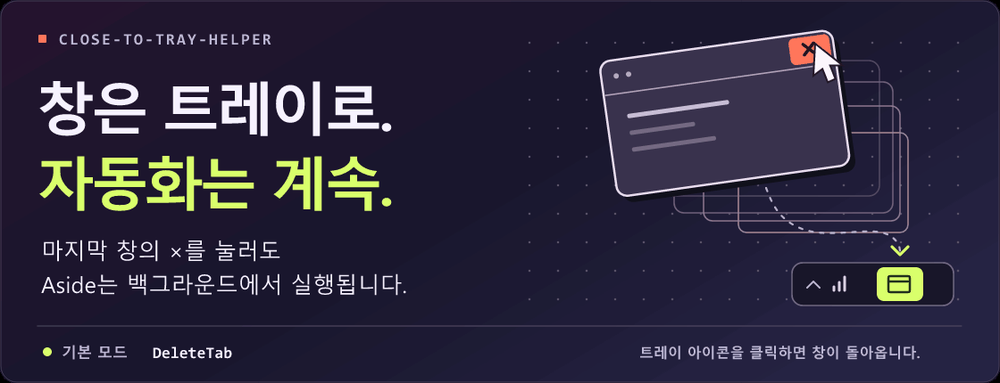
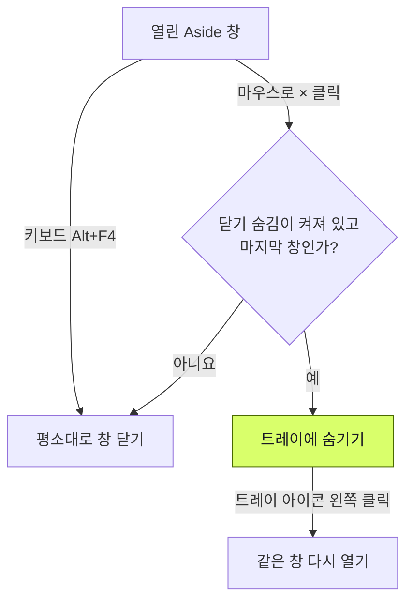
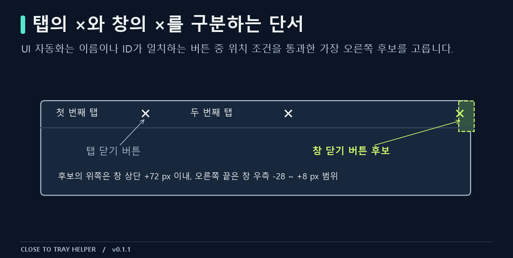

# Close to Tray Helper

> **[English README](README.md)** · **[동작을 그림으로 보기](docs/VISUAL-GUIDE.md)** · **[보안 정책 (SECURITY.md)](SECURITY.md)** · **[최신 릴리스](https://github.com/Technoetic/close-to-tray-helper/releases/latest)**

<picture>
  <source media="(prefers-reduced-motion: reduce)" srcset="docs/visuals/hero.png">
  
</picture>

**Aside에서 명령줄 자동화를 돌리는 동안 브라우저 창을 치우고 싶을 때 쓰는 Windows 도우미입니다.** 마지막 창의 `×`를 마우스 왼쪽으로 누르면 작업 표시줄에서 창이 사라지고 브라우저는 계속 실행됩니다. 다시 보고 싶을 때는 시계 옆 트레이 아이콘을 한 번 클릭하세요.

[최신 릴리스 받기](https://github.com/Technoetic/close-to-tray-helper/releases/latest) · [동작을 그림으로 보기](docs/VISUAL-GUIDE.md) · [실행 스크립트 읽기](close-to-tray.ps1)

## 도우미와 스킬 함께 설치하기

**준비물**은 Windows 10 또는 11(64비트), 설치된 Aside AI 브라우저, Windows 기본 64비트 PowerShell 5.1, .NET Framework 4.x, Windows Script Host입니다. 32비트 PowerShell로는 64비트 브라우저 프로세스를 확인할 수 없습니다.

1. [최신 릴리스](https://github.com/Technoetic/close-to-tray-helper/releases/latest)에서 슬림 배포본 **`close-to-tray-helper-0.3.0-windows.zip`**(약 68 KB, 도감 이미지 제외)과 필요 시 **`SHA256SUMS.txt`**를 받아 압축을 풉니다.
2. 폴더의 **`install.cmd`**를 두 번 클릭합니다(Git 복제본에서는 `.\install.cmd`).
   - 도우미와 제거기(`uninstall.cmd`)가 `%LOCALAPPDATA%\CloseToTrayHelper\app`에 설치됩니다.
   - `aside-repl` 스킬은 이 PC에 **설정 폴더가 존재하는 AI 도구**(Antigravity · Claude Code · Codex)에만 자동 설치되며, 쓰지 않는 도구 폴더는 만들지 않습니다.
   - 트레이 도우미만 설치하려면 `.\install.cmd -AppOnly`(또는 `-SkipSkills`), 세 도구 모두 설치하려면 `.\install.cmd -AllHosts`, 업그레이드 시 실행 중인 도우미를 자동 재시작하려면 `.\install.cmd -Restart`를 붙이세요.
3. 도우미를 시작하려면 `Win+R`을 누르고 아래 경로를 입력합니다. Windows 11에서는 시계 옆 **숨겨진 아이콘 표시(∧)**에서 트레이 아이콘을 찾을 수 있습니다.

```text
%LOCALAPPDATA%\CloseToTrayHelper\app\close-to-tray-launch.vbs
```

새 릴리스로 업데이트할 때도 같은 설치 파일을 실행하세요. 직접 설치한 동명 스킬이나 수정한 설치 파일이 있으면 설치기가 충돌 경로를 표시하고 안전하게 중단합니다. 이미 도우미가 실행 중이라면 업그레이드 후 재시작 안내를 표시합니다(`-Restart`로 자동 재시작 가능).

> **처음 써보기** — Aside 창 하나를 열고 오른쪽 위 `×`를 클릭한 뒤, 트레이 아이콘을 왼쪽 클릭해 보세요. 같은 창이 돌아옵니다. 브라우저를 실제로 끝내려면 마지막 창에서 `Alt+F4`를 누르세요.

## 트레이에 둔 브라우저로 README 제목 읽기

Antigravity(agy), Claude Code, Codex는 같은 [스킬과 실행 예제](.agents/skills/aside-repl/SKILL.md)를 사용합니다. 설치한 뒤 원하는 프로젝트에서 새 대화를 열고, 아래 호출 뒤에 **“https://github.com/Technoetic/close-to-tray-helper 에서 README의 첫 제목을 읽어 줘.”**라고 적어 보세요.

| 도구 | 호출 | 사용자별 기본 스킬 폴더 |
|---|---|---|
| Antigravity (agy) | `/aside-repl` | `%USERPROFILE%\.gemini\config\skills\aside-repl` |
| Claude Code | `/aside-repl` | `%USERPROFILE%\.claude\skills\aside-repl` |
| Codex | `$aside-repl` | `%USERPROFILE%\.agents\skills\aside-repl` |

`CLAUDE_CONFIG_DIR` 또는 `CODEX_HOME`을 지정한 계정(정션·심볼릭 링크로 연결된 `.claude` dotfiles 폴더 포함)에서도 해당 설정 폴더 아래의 `skills\aside-repl`에 설치합니다. [Antigravity 스킬](https://antigravity.google/docs/customization-discovery?tab=cli) · [Claude Code 스킬](https://code.claude.com/docs/en/skills) · [Codex 스킬](https://learn.chatgpt.com/docs/build-skills)

**PowerShell에서 직접** 실행할 때는 설치된 스킬 폴더 중 하나를 사용하세요. 이 예제에는 실행 중인 Aside, PATH에 등록된 `aside` CLI, Python 3가 필요합니다(기본 `--timeout 120`초 제한).

```powershell
$skill = Join-Path $env:USERPROFILE '.gemini\config\skills\aside-repl'
python "$skill\scripts\run_repl.py" "$skill\examples\readme-title.js"
```

실행기가 알려 주는 `stdout.txt`를 열면 `{"heading":"Close to Tray Helper"}`를 확인할 수 있습니다. 예제는 자신이 연 탭만 닫습니다. [예제 코드 보기](.agents/skills/aside-repl/examples/readme-title.js)

## 어느 클릭이 트레이로 갈까?



창이 두 개일 때 `×`를 누르면 클릭한 창만 닫힙니다. `×` 대신 **최소화(－)**를 눌러도 도우미가 해당 창을 트레이로 보냅니다. 숨겨진 Chromium 창은 그리기 빈도가 낮아지므로, 애니메이션을 눈으로 확인할 때는 창을 다시 여세요.

### 숨김 방식 고르기

| 트레이 메뉴에서 고를 모드 | 창이 숨겨진 동안 | 도우미가 갑자기 종료되면 |
|---|---|---|
| **작업 표시줄만 숨기기** · `DeleteTab` · 기본값 | 브라우저 창을 최소화하고 실행 중인 창의 작업 표시줄 버튼을 제거합니다. | 도우미를 다시 켜면 최소화된 창을 찾을 수 있습니다. |
| **완전 숨기기** · `HideWindow` · 실험 기능 | 창에 `SW_HIDE`를 적용합니다. 작업 표시줄과 `Alt+Tab`에서 모두 사라집니다. | 숨겨진 창을 다시 찾지 못할 수 있습니다. 이때는 작업 관리자에서 브라우저를 종료한 뒤 다시 시작해야 합니다. |

평소에는 **작업 표시줄만 숨기기**를 권장합니다. 브라우저를 작업 표시줄에 고정해 뒀다면 고정 아이콘은 계속 보입니다. 도우미를 메뉴나 `-Stop`으로 정상 종료하거나 Windows에서 로그아웃하면 숨겼던 창의 작업 표시줄 버튼을 복원하고 마우스 훅을 해제합니다.

<details>
<summary><strong>트레이 아이콘을 오른쪽 클릭하면 나오는 메뉴 12개</strong></summary>

| 메뉴 | 사용 시점 |
|---|---|
| 브라우저 창 열기 | 숨겨 둔 창을 다시 볼 때 |
| 트레이로 즉시 숨기기 | 열려 있는 창을 바로 치울 때 |
| 브라우저 시작 (트레이로) | 브라우저를 새로 시작해 트레이에 둘 때 |
| 브라우저가 붙잡은 메모리: N GB | 쌓인 메모리를 볼 때(정보 줄, 누를 수 없음) |
| 브라우저 다시 시작 (메모리 정리) | 쌓인 메모리를 바로 풀 때 |
| 메모리가 많으면 자리 비운 사이 자동 다시 시작 | 자동 다시 시작을 켜고 끌 때 |
| 숨김 방식: 작업 표시줄만 숨기기 (권장) | 기본 최소화 상태를 유지할 때 |
| 숨김 방식: 완전 숨기기 (Alt+Tab 포함) | 창 전환 목록에서도 숨길 때 |
| 닫기(×) 클릭 시 트레이로 숨기기 | 마지막 창의 닫기 동작을 전환할 때 |
| Windows 로그인 시 자동 실행 | 다음 로그인부터 도우미를 시작할 때 |
| 도우미 시작 시 브라우저도 자동 시작 | 도우미와 브라우저를 함께 시작할 때 |
| 트레이 도우미 종료 (브라우저 창 복원) | 숨긴 창을 복원하고 도우미를 끝낼 때 |

</details>

## 메모리가 쌓이면 브라우저를 다시 시작하기

일부 Aside 빌드(`1.0.1116.2`에서 확인)는 주 브라우저 프로세스가 128KB짜리 공유 메모리 영역(페이지 파일을 뒤에 둔 섹션)을 분당 약 60개씩 열고 닫지 않아 하루에 약 10GB가 쌓입니다([공개 신고](https://github.com/at-inc/docs/issues/18)). 이 메모리는 Windows의 메모리 약정 한도를 차지하지만 어느 프로세스의 개인 메모리(private bytes)에도 잡히지 않아 작업 관리자로는 보이지 않고, 브라우저가 끝나야만 풀립니다. 이 도우미는 브라우저를 며칠씩 켜 두게 하므로 한도가 찰 수 있고, 그러면 다른 프로그램들이 메모리 부족 오류로 실패합니다.

그래서 도우미가 자리를 비운 사이에 브라우저를 다시 시작합니다.

| 단계 | 하는 일 |
|---|---|
| 재기(60초마다) | 브라우저 프로세스들의 공유 메모리 약정(`SharedCommitUsage`) 가운데 가장 큰 값을 읽습니다(Windows 10·11 22H2에 2023년 9월 업데이트 이상. 그보다 옛 버전에서는 트레이에 '측정 불가'로 보입니다). 프로세스는 계수기를 읽는 권한(`PROCESS_QUERY_LIMITED_INFORMATION`)으로 열고, 프로세스 메모리는 읽지 않습니다. 트레이 메뉴에 그 값이 보이며, 1GB는 1024³바이트로 셉니다. |
| 판단 | 그 값이 **4GB**에 이르고, 브라우저 창이 **하나이며 트레이에 있고**, Aside CLI가 돌지 않으며 **15분** 안에 돈 적도 없고(도우미가 켜진 뒤로 셉니다), 전체 화면 앱이나 프레젠테이션 모드가 아니며, 브라우저가 **소리를 내거나 녹음하지 않고**(다른 조건이 모두 맞을 때만 Windows에 묻습니다), **10분** 동안 키보드·마우스 입력이 없을 때만 다시 시작합니다. 숨은 브라우저 창도 셉니다. 창이 두 개 이상이면 정상 종료 뒤 마지막 창만 되살아나므로 다시 시작하지 않습니다. |
| 닫기 | 브라우저 창에 정상 종료 요청(`WM_CLOSE`)을 보내고 브라우저 프로세스가 끝나기를 최대 60초 기다립니다. 창은 모두 닫혔는데 프로세스가 아직 끝나는 중이면 60초를 더 기다립니다. 강제 종료는 하지 않습니다. |
| 다시 열기 | 실행 중이던 바로 그 브라우저 실행 파일(경로를 읽지 못하면 설정되거나 찾아낸 `Aside.exe`)을 `--restore-last-session`으로 다시 시작해 탭을 되살립니다. 다시 열린 창이 잠깐 보였다가 도우미가 트레이로 다시 내립니다(창마다 최대 두 번. 사용자가 다시 꺼낸 창은 그대로 둡니다). |

다시 시작에 성공하면 1시간, 실패하면 6시간 동안 자동 다시 시작을 쉽니다. 이 쉬는 시간과 아래 '창 없이 계속 도는 브라우저'의 표시는 메모리에만 있어서, 도우미를 다시 켜면 사라집니다.

- **바로 다시 시작:** 트레이 메뉴의 **브라우저 다시 시작 (메모리 정리)**나 `-RestartBrowser`는 메모리 값·입력 여부·소리·창 상태와 관계없이 바로 다시 시작합니다. 거절할 때는 알림으로 이유를 알립니다: 브라우저 창이 두 개 이상, 보이지 않는 브라우저 창 있음(이때는 브라우저를 직접 끝내야 메모리가 풀립니다), Aside CLI 실행 중, 브라우저 미실행 또는 창 없음, 이미 시작하거나 다시 시작하는 중(페이지 확인 창의 답을 기다리는 동안은 최대 30분), 다시 띄울 실행 파일 없음(이때는 아무것도 닫지 않습니다). 화면에 열려 있던 창은 다시 화면에 열립니다.
- **창이 닫히지 않을 때**(예: 사이트를 떠날지 묻는 확인 창): 창을 보여 주고 알림을 띄운 뒤 최대 30분 기다립니다. 그사이 브라우저가 닫히면(나가기를 골랐거나 직접 닫은 경우) 다시 엽니다. 취소를 고르면 브라우저는 그대로 두지만, 그 30분이 끝날 때까지는 브라우저를 닫아도 다시 열리고 바로 다시 시작은 쓸 수 없습니다. 30분이 지나면 기다리기를 그만두고 6시간 동안 다시 시도하지 않으며, 그 뒤에 브라우저를 닫아도 다시 열지 않습니다. 기다리는 동안 도우미를 끄면 그때도 다시 열지 않습니다.
- **창 없이 계속 도는 브라우저**(예: 백그라운드에서 계속 실행 설정): 창을 다시 열고 알림으로 알려 줍니다. 메모리가 풀리지 않았으므로 그 브라우저 프로세스는 자동으로는 다시 시작하지 않습니다.
- **다시 시작 도중 도우미 종료:** 브라우저가 닫혔고 아직 다시 열리지 않은 동안에는 도우미가 다시 시작을 마친 뒤에 끝납니다. 그동안 트레이 메뉴의 종료 항목은 쓸 수 없고, 종료 요청(`-Stop` 등)은 브라우저가 다시 열린 뒤에 적용됩니다(길어야 약 2분). `-Stop` 명령 자체는 바로 돌아오므로, 도우미를 다시 켜려면 먼저 끝나기를 기다리세요. `install.ps1 -Restart`와 `uninstall.ps1`은 최대 130초 기다리고, 그보다 길어지면 알려 줍니다. 트레이 아이콘이 없어지므로 다시 열린 창은 화면에 그대로 열립니다. 다시 시작 도중 Windows가 로그아웃하거나 꺼지고 그것을 5초 안에 확정하면 브라우저를 다시 열지 않고, 로그아웃이 취소되면 다시 엽니다.
- **경고 알림:** 값이 기준의 두 배(기본값으로 8GB, 자동 다시 시작을 꺼 둔 때도 포함)가 되었는데 다시 시작할 수 없으면 메뉴에서 다시 시작하라는 알림을 한 시간에 한 번까지 띄웁니다.
- **`prefs.json` 설정:** `autoRestart`(JSON `true`·`false`, 기본 `true`), `restartAtGB`(기본 `4`. `0`이면 메모리 기준을 끔, 그 밖에는 0.5–1024), `restartAfterHours`(기본 `0` = 끔, 그 밖에는 1–720. 메모리 값을 잴 수 없는 Windows에서 브라우저 가동 시간 기준으로 다시 시작), `restartIdleMinutes`(기본 `10`, 1–1440). 숫자 세 개는 `"6.5"`처럼 문자열로 적어도 됩니다. 값이 없거나 다른 형식이거나 범위를 벗어나면 그 키만 기본값으로 돌아가고 다른 키에는 영향이 없습니다. 도우미는 시작할 때 파일을 읽고 트레이 메뉴에서 설정을 바꾸면 파일을 다시 쓰므로, 파일은 도우미를 끈 상태에서 고치세요.
- **확인한 것**(Windows 11 빌드 26300, Aside `1.0.1116.2`): 창 하나가 트레이에 있을 때 다시 시작하자 약 1초 안에 새 브라우저 프로세스가 떴고, 같은 탭 7개가 다시 열렸으며, 이후 1분 동안 확인할 때마다 창은 트레이에 있었습니다. 주 브라우저 프로세스의 공유 메모리 약정은 0.48GB(다시 시작 4분 반 전의 마지막 5분 간격 측정)에서 0.12GB(다시 시작 36초 뒤)로 줄었습니다. Aside CLI 명령이 도는 중과 창이 두 개일 때는 다시 시작 요청이 거절됐습니다. 다시 시작 요청 0.2초 뒤에 보낸 종료 요청에서는 도우미가 브라우저가 다시 열린 뒤에야 끝났습니다(다시 시작이 없을 때는 약 70ms 안에 끝납니다). 마지막 검토 수정 직전 코드로도 트레이 재시작을 다시 했습니다: 약 1초 안에 새 브라우저 프로세스가 떴고, 같은 탭 7개가 열렸으며, 이후 1분 동안 확인할 때마다 창은 트레이에 있었고, 앞에 있던 다른 프로그램이 그대로 앞 창이었습니다. Aside CLI 프로세스가 도는 동안 보낸 다시 시작 요청은 거절됐습니다. 최종 코드로 한 번 더 했을 때도 프로세스·탭·트레이는 같은 결과였습니다(다시 시작 직전에 끝난 Aside CLI 호출이 남긴 빈 탭은 돌아오지 않았습니다). 이때는 PC를 쓰던 중이라 앞 창이 유지됐는지는 이 시험으로 알 수 없습니다.

## 설치 환경에 맞게 설정하기

PowerShell에서 직접 실행할 때는 `-STA`를 붙입니다. 로그인할 때마다 실행하려면 아래 두 번째 명령을 한 번 사용하세요.

```powershell
# 현재 세션에서 직접 실행
$helper = Join-Path $env:LOCALAPPDATA 'CloseToTrayHelper\app\close-to-tray.ps1'
powershell -NoProfile -ExecutionPolicy Bypass -STA -File "$helper"

# 선택 사항: Windows 로그인 시 자동 실행
powershell -NoProfile -ExecutionPolicy Bypass -File "$helper" -InstallStartup
```

숨김 방식, 닫기 버튼 처리, 브라우저 동시 시작 여부, 메모리 기준 다시 시작 설정은 `%LOCALAPPDATA%\CloseToTrayHelper\prefs.json`에 저장됩니다. **Windows 로그인 시 자동 실행**은 시작프로그램 폴더의 `Close To Tray Helper.lnk`로 관리합니다. 도우미 폴더를 옮겼다면 `-InstallStartup`을 다시 실행하세요.

<details>
<summary><strong>명령줄 옵션 전체 보기</strong></summary>

| 옵션 | 동작 |
|---|---|
| `-Mode DeleteTab` / `-Mode HideWindow` | 숨김 방식을 지정하고 저장합니다. |
| `-CloseToTray` / `-NoCloseToTray` | 마지막 창의 닫기 버튼 처리를 켜거나 끄고 저장합니다. |
| `-StartAside` | 이번 도우미 실행과 함께 브라우저를 시작합니다. |
| `-Show` / `-Hide` / `-Toggle` | 실행 중인 도우미에 창 표시·숨김·전환 명령을 보냅니다(`running`/`sent`로 실제 전달 여부 보고). |
| `-Stop` | 숨긴 창을 복원하고 실행 중인 도우미를 종료합니다. 명령은 바로 돌아오며, 브라우저를 다시 시작하는 중이면 도우미는 브라우저가 다시 열린 뒤에 끝납니다. |
| `-InstallStartup` / `-UninstallStartup` | 로그인용 바로 가기를 만들거나 제거합니다. |
| `-AsideExe <경로>` | 사용할 브라우저 실행 파일을 지정합니다. |
| `-AsideUpScript <경로>` | 브라우저 시작용 스크립트를 지정합니다. 기본 위치는 도우미 옆의 `aside-up.ps1`입니다. 스크립트가 없으면 브라우저 실행 파일을 직접 시작합니다. |
| `-PrefsPath <파일>` / `-StartupDir <폴더>` | 별도 설정 파일이나 시작프로그램 폴더를 사용합니다. |
| `-RestartBrowser` | 실행 중인 도우미에 브라우저를 지금 다시 시작하라고 보냅니다(정상 종료 뒤 `--restore-last-session`으로 다시 엶). |
| `-PolicyTest` | 다시 시작 판단 표와 `prefs.json` 읽기를 시험합니다. 창을 띄우지 않습니다. |
| `-Restart` | 이 스크립트의 옵션이 아닙니다(`-Restart`는 `install.cmd`의 옵션). `-RestartBrowser`의 줄임말로 읽히지 않도록 안내만 출력하고 종료 코드 2로 끝납니다. |
| `-SelfTest` | 오프라인 자체 시험을 실행합니다. |
| `-Json` | 결과를 JSON으로 출력합니다. |

`-AsideExe`나 환경 변수 `ASIDE_EXE`에 경로를 지정하면 그 경로만 사용합니다. 둘 다 생략하면 `%ProgramFiles%`, `%ProgramFiles(x86)%`, `%LOCALAPPDATA%` 아래의 기본 설치 폴더를 찾습니다. 메모리 기준 다시 시작은 실행 중이던 실행 파일을 다시 띄우고, 그 경로를 읽지 못할 때만 이 경로를 씁니다(시작 스크립트는 쓰지 않습니다).

도우미는 이름 있는 뮤텍스 `Local\Close-To-Tray-Helper`로 한 번만 실행됩니다. 이미 실행 중이면 두 번째 실행은 끝나므로 `-Mode` 같은 시작 옵션으로 기존 설정을 바꿀 때는 트레이 메뉴를 이용하거나 `-Stop`으로 끈 뒤 끝나기를 기다렸다가 다시 시작하세요.

</details>

## 닫기 버튼을 어떻게 구분하나?



탭에 붙은 작은 `×`는 탭을 닫는 데 계속 쓸 수 있습니다. 도우미가 찾는 것은 **창 전체의 오른쪽 위 닫기 버튼**입니다.

도우미는 Windows 전역의 마우스 왼쪽 클릭을 살핍니다. 먼저 클릭한 위치가 UI Automation에 저장된 마지막 창의 닫기 버튼 영역에 들어가는지 확인합니다. 여기서 일치하지 않으면 Windows에 그 지점이 닫기 버튼인지 묻습니다(`WM_NCHITTEST` → `HTCLOSE`). 조건이 맞으면 누름과 뒤따르는 뗌을 처리하고 창을 숨깁니다. 키보드 입력을 후킹하거나 클릭을 기록·전송하는 기능은 없습니다. 도우미 자체는 네트워크에 연결하지 않으며 브라우저 파일을 수정하거나 브라우저에 코드를 주입하지 않습니다. 자세한 위협 모델은 [SECURITY.md](SECURITY.md)를 참고하세요.

| 이런 현상이 보이면 | 이렇게 대응하세요 |
|---|---|
| 브라우저가 멈출 때 마우스도 잠시 느려짐 | 마우스 훅(`WH_MOUSE_LL`)이 도우미 UI 스레드에서 실행됩니다. 트레이 메뉴의 **닫기(×) 클릭 시 트레이로 숨기기**를 끄면 훅이 해제됩니다. |
| 브라우저 업데이트 뒤 닫기 버튼 감지가 달라짐 | 브라우저의 창 구조가 바뀌면 감지가 깨질 수 있습니다. 같은 메뉴에서 해당 기능을 끄세요. |
| 자리를 비운 사이 브라우저가 다시 시작됨 | 메모리 기준 다시 시작 기능입니다. 창 하나가 트레이에 있고, 브라우저가 소리를 내지 않으며, 10분 동안 입력이 없을 때만 돕니다. 탭은 되살아나지만, 저장하지 않은 웹 입력란 내용처럼 정상 종료로 사라지는 것은 여기서도 사라집니다. 트레이 메뉴에서 끌 수 있습니다. |
| 백신이나 회사 보안 프로그램이 경고함 | 숨김 PowerShell, 전역 마우스 훅, 시작프로그램 바로 가기가 경고 대상일 수 있습니다. 실행 전에 스크립트와 조직의 사용 정책을 확인하세요. |

**시험 환경**은 Windows 11과 Aside `1.0.1116.2`입니다. 이 PC에서는 Aside가 자체 트레이 아이콘을 등록한 기록이 없었고, 마지막 창을 닫으면 백그라운드 데몬도 끝나 CLI 자동화가 중단됐습니다. 2026년 11월 21일 확인한 브라우저 공식 문서에는 트레이로 숨기는 옵션 설명이 없었습니다. 변경 기록에는 Windows 트레이 메뉴와 `keep-tasks-running` 설정이 언급되어 있어, 다른 버전이나 상황에서의 동작은 달라질 수 있습니다. 이 프로젝트는 Aside 제작사와 제휴·후원·지원 관계가 없는 비공식 도구입니다.

## 동작을 그림으로 더 보기

[**시각 도감 열기 →**](docs/VISUAL-GUIDE.md) 트레이에서 숨긴 창이 돌아오기까지의 메시지, 마지막 창 판정, 겹친 창에서의 클릭 처리, 실제 시험 좌표를 그림으로 살펴볼 수 있습니다.

<details>
<summary><strong>시험 명령과 제거 방법</strong></summary>

Windows에서 기본 시험(32개)은 파일 형식(ASCII·BOM)·PowerShell 문법·IPC 미실행 판정·다시 시작 판단 표·설정 검증·최소 권한과 강제 종료 금지·시작프로그램 바로 가기·설치기/제거기(정션·`-AppOnly`·`v0.2.0` 업그레이드 포함)·`run_repl.py` 타임아웃·슬림 릴리스 ZIP을 검사합니다.

```powershell
python -m unittest discover -s tests -v
```

바탕 화면 시험은 내장 C# 제어기를 컴파일하고 작은 최상위 시험 창 세 개를 잠시 띄워 클릭 감지, 여러 창의 동작과 훅 해제를 검사합니다. 이 시험까지 포함(총 33개)하려면 다음을 실행하세요.

```powershell
$env:CLOSE_TO_TRAY_SELFTEST = '1'
python -m unittest discover -s tests -v
```

제거기나 ZIP 설치 왕복을 돌리는 시험은 같은 세션에서 도우미가 돌고 있으면 스스로 건너뜁니다(제거기가 도우미를 끄기 때문). CI에서는 모두 돕니다.

**제거**할 때는 설치된 **`%LOCALAPPDATA%\CloseToTrayHelper\app\uninstall.cmd`**(또는 배포 폴더의 `.\uninstall.cmd`)를 실행하세요. 실행 중인 도우미를 종료하고 숨긴 창을 복원한 뒤 시작프로그램 바로 가기와 SHA-256 매니페스트로 관리되는 파일만 안전하게 삭제합니다(직접 추가한 파일은 보존, 수정한 파일은 `-Force` 없이는 삭제 차단, 설정 유지 시 `-KeepPrefs`).

</details>

## 변경 이력과 라이선스

- **[v0.3.0 · 2026-11-25](https://github.com/Technoetic/close-to-tray-helper/releases/tag/v0.3.0)** — 메모리 기준 다시 시작 추가: 브라우저가 쌓은 공유 메모리(`SharedCommitUsage`)를 재어 4GB에 이르고, 브라우저 창 하나가 트레이에 있고, 15분 동안 Aside CLI가 돌지 않았고, 전체 화면이 아니며, 브라우저가 소리를 내지 않고, 10분 동안 입력이 없을 때 브라우저를 정상 종료한 뒤 `--restore-last-session`으로 다시 엽니다(트레이 메뉴 켜기·끄기, 즉시 다시 시작 메뉴, `-RestartBrowser`, `-PolicyTest`, `prefs.json` 키 4개). 브라우저가 닫혀 있는 동안 받은 종료 요청은 브라우저가 다시 열린 뒤에 적용되고, `install.ps1 -Restart`와 `uninstall.ps1`은 최대 130초 기다린 뒤 도우미가 아직 돌면 알려 줍니다. `prefs.json`에 `mode` 키가 없으면 다른 설정까지 모두 버리던 문제를 고쳤습니다.
- [v0.2.1 · 2026-11-22](https://github.com/Technoetic/close-to-tray-helper/releases/tag/v0.2.1) — Windows GitHub Actions CI·`SECURITY.md`·슬림 릴리스 ZIP + `SHA256SUMS.txt` 추가, 설치기 스마트 감지(`-AppOnly`/`-SkipSkills`/`-AllHosts`/`-Restart`, 상위 정션 허용, 실행 중 업그레이드 안내) 및 `uninstall.cmd`/`uninstall.ps1` 추가, `run_repl.py` 120초 타임아웃·단위 시험 추가, `-InstallStartup -Json` `icon_exe`·IPC 수신 확인·3툴팁 길이 검사 수정, 시각 도감(`v0.2.1`) 동기화 및 영문/한글 README 분리.
- [v0.2.0 · 2026-11-21](https://github.com/Technoetic/close-to-tray-helper/releases/tag/v0.2.0) — Windows 설치 한 번으로 트레이 도우미와 Antigravity·Claude Code·Codex용 `aside-repl`을 함께 설치합니다.
- [v0.1.1 · 2026-11-21](https://github.com/Technoetic/close-to-tray-helper/releases/tag/v0.1.1) — 트레이와 바로 가기에 Windows 표준 아이콘을 사용합니다. 콘솔 출력은 `[close-to-tray]`로 시작합니다. 브라우저 자체 트레이 기능에 관해 확인한 범위를 문서화했습니다.
- [v0.1.0 · 2026-11-21](https://github.com/Technoetic/close-to-tray-helper/releases/tag/v0.1.0) — 첫 공개 버전입니다.

[MIT 라이선스 전문](LICENSE)
