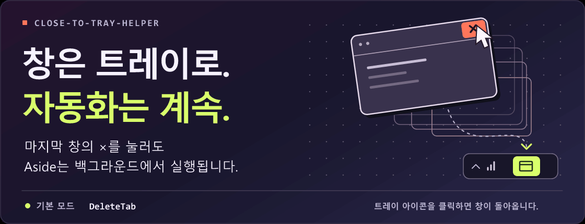
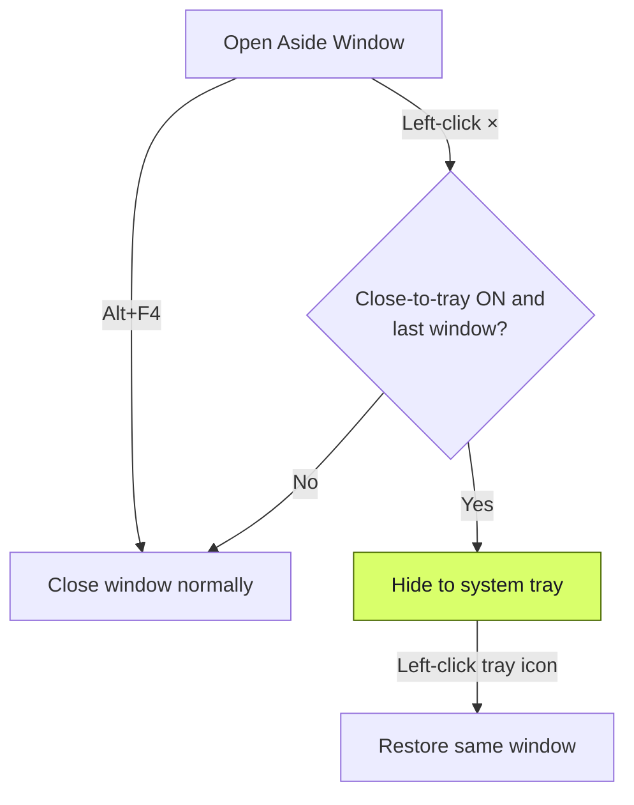
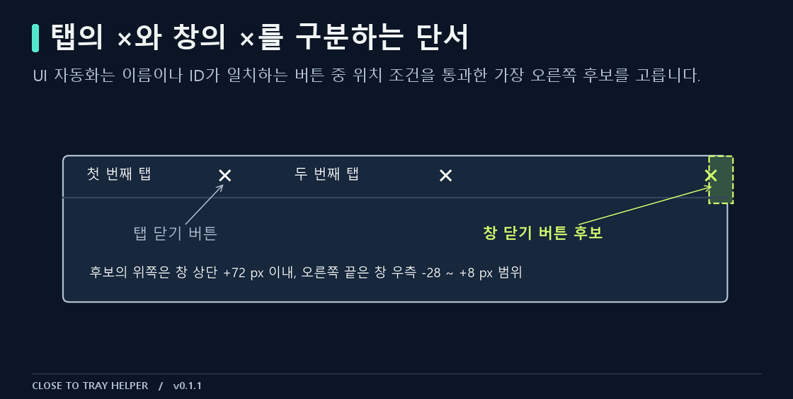

# Close to Tray Helper

> **[한국어 README 보기](README.ko.md)** · **[Visual Guide (한국어)](docs/VISUAL-GUIDE.md)** · **[Security Policy](SECURITY.md)** · **[Latest Release](https://github.com/Technoetic/close-to-tray-helper/releases/latest)**

<picture>
  <source media="(prefers-reduced-motion: reduce)" srcset="docs/visuals/hero.png">
  
</picture>

**Unofficial Windows helper that keeps the Aside browser running in the system tray while CLI automation works.** Left-clicking `×` on the last window hides it from the taskbar without terminating the browser or its daemon; left-clicking the tray icon restores the same window.

[Download Latest Release](https://github.com/Technoetic/close-to-tray-helper/releases/latest) · [Read `close-to-tray.ps1`](close-to-tray.ps1) · [Read `SECURITY.md`](SECURITY.md)

## Quick Install (Windows 10 / 11)

**Requirements:** Windows 10 or 11 (64-bit), installed Aside browser, built-in 64-bit Windows PowerShell 5.1, .NET Framework 4.x, and Windows Script Host. (32-bit PowerShell cannot inspect 64-bit browser processes.)

1. Download **`close-to-tray-helper-0.2.1-windows.zip`** (slim package, ~45 KB — excludes repo docs/visuals) and optional **`SHA256SUMS.txt`** from [Latest Release](https://github.com/Technoetic/close-to-tray-helper/releases/latest), then extract the ZIP.
2. Double-click **`install.cmd`** (or run `.\install.cmd` in PowerShell):
   - Installs the tray helper and uninstaller to `%LOCALAPPDATA%\CloseToTrayHelper\app`.
   - Automatically installs the `aside-repl` skill **only** for detected AI coding agents (Antigravity, Claude Code, Codex) — never creates folders for agents you do not use.
   - Pass **`-AppOnly`** (or `-SkipSkills`) to install only the tray helper, **`-AllHosts`** to install skills for all three agents, or **`-Restart`** to automatically restart a running helper during upgrade.
3. Launch the helper via `Win+R` (on Windows 11, check **Show hidden icons (`^`)** next to the clock):

```text
%LOCALAPPDATA%\CloseToTrayHelper\app\close-to-tray-launch.vbs
```

> **First test:** Open one Aside window, click its top-right `×`, then left-click the tray icon — the exact same window returns. To actually exit the browser, press `Alt+F4` on the last window.

### Uninstall

Run **`%LOCALAPPDATA%\CloseToTrayHelper\app\uninstall.cmd`** (or `.\uninstall.cmd` from the release folder). It stops a running helper (restoring hidden windows first), removes the Startup shortcut, verifies SHA-256 manifests before removing managed files, preserves any extra files you added, and refuses to delete locally edited files unless `-Force` is passed. Use `-KeepPrefs` to keep `prefs.json`.

## Optional `aside-repl` Skill (Antigravity · Claude Code · Codex)

All three hosts share the same [skill and runner](.agents/skills/aside-repl/SKILL.md). Once installed, open a new conversation and ask: **"Read the first heading of https://github.com/Technoetic/close-to-tray-helper README."**

| Tool | Trigger | Default User Skill Path |
|---|---|---|
| Antigravity (`agy`) | `/aside-repl` | `%USERPROFILE%\.gemini\config\skills\aside-repl` |
| Claude Code | `/aside-repl` | `%USERPROFILE%\.claude\skills\aside-repl` |
| Codex | `$aside-repl` | `%USERPROFILE%\.agents\skills\aside-repl` |

Custom `CLAUDE_CONFIG_DIR` and `CODEX_HOME` paths (including symlinked/junctioned agent config directories) are respected automatically. [Antigravity skills](https://antigravity.google/docs/customization-discovery?tab=cli) · [Claude Code skills](https://code.claude.com/docs/en/skills) · [Codex skills](https://learn.chatgpt.com/docs/build-skills)

**Direct PowerShell run** (requires running Aside, `aside` on `PATH`, and Python 3; default `--timeout 120` seconds):

```powershell
$skill = Join-Path $env:USERPROFILE '.gemini\config\skills\aside-repl'
python "$skill\scripts\run_repl.py" "$skill\examples\readme-title.js"
```

Inspect the `stdout.txt` path reported in JSON to verify `{"heading":"Close to Tray Helper"}`. [View example](.agents/skills/aside-repl/examples/readme-title.js)

## How Close-to-Tray Decides



When two or more browser windows are open, clicking `×` closes that window normally. Minimizing (`-`) also moves the window to the tray.

### Hide Modes

| Mode (Tray Menu) | While Hidden | If Helper Process Is Force-Killed |
|---|---|---|
| **DeleteTab** (default, recommended) | Minimizes the window and removes its taskbar button (`ITaskbarList::DeleteTab`). | Relaunching the helper finds the minimized window cleanly. |
| **HideWindow** (experimental) | Hides the window with `SW_HIDE` (removed from taskbar and `Alt+Tab`). | A restarted helper cannot see previously `SW_HIDE` windows; restart the browser from Task Manager. |

Normal exit (tray menu or `-Stop`) and Windows logoff restore all hidden windows and unhook the mouse hook.

<details>
<summary><strong>CLI Options & Startup Shortcut</strong></summary>

```powershell
# Run directly in current session (-STA required)
$helper = Join-Path $env:LOCALAPPDATA 'CloseToTrayHelper\app\close-to-tray.ps1'
powershell -NoProfile -ExecutionPolicy Bypass -STA -File "$helper"

# Optional: start automatically at Windows sign-in
powershell -NoProfile -ExecutionPolicy Bypass -File "$helper" -InstallStartup
```

| Option | Behavior |
|---|---|
| `-Mode DeleteTab` / `-Mode HideWindow` | Set and persist hide mode in `%LOCALAPPDATA%\CloseToTrayHelper\prefs.json`. |
| `-CloseToTray` / `-NoCloseToTray` | Enable or disable last-window `×` interception and persist. |
| `-StartAside` | Launch the browser when starting this helper instance. |
| `-Show` / `-Hide` / `-Toggle` / `-Stop` | Send IPC command to the running helper (`running` and `sent` report whether a listener received it). |
| `-InstallStartup` / `-UninstallStartup` | Create or remove `%APPDATA%\Microsoft\Windows\Start Menu\Programs\Startup\Close To Tray Helper.lnk`. |
| `-AsideExe <path>` / `-AsideUpScript <path>` | Override browser binary or optional launch helper script. |
| `-PrefsPath <file>` / `-StartupDir <dir>` | Override settings file or Startup directory. |
| `-SelfTest` / `-Json` | Run offline Win32 self-test / emit machine-readable JSON. |

Single-instance lock uses `Local\Close-To-Tray-Helper`.

</details>

## Close Button Detection & Safety Disclosures



Tab `×` buttons continue to close tabs normally. The helper monitors global left-clicks via `WH_MOUSE_LL`, first checks a bounded UI Automation cache for the rightmost top-corner window Close button (skipping web `Document` subtrees), and falls back to `WM_NCHITTEST` → `HTCLOSE`. Zero keyboard hooking, zero click logging, zero network calls, zero DLL injection. See [SECURITY.md](SECURITY.md) for the full threat model.

- **Mouse stutter on hung browser:** `WH_MOUSE_LL` runs on the helper UI thread. Uncheck **닫기(×) 클릭 시 트레이로 숨기기** in the tray menu to unhook immediately.
- **AV / EDR warnings:** Unsigned hidden PowerShell, `WH_MOUSE_LL`, and Startup shortcuts can trigger security alerts. Review the source and your organization policy first.
- **Test environment & unofficial status:** Verified on Windows 11 with Aside `1.0.1116.2`. On the test PC, Aside registered no native tray icon and closing the last window stopped `aside-daemon.exe`. Aside's public docs checked on 2026-11-21 did not document a hide-to-tray option, though changelogs mention Windows tray menus and `keep-tasks-running`; behavior on other versions may differ. Unofficial project, not affiliated with or endorsed by the makers of Aside.

## Tests

```powershell
# Default suite (24 tests: PowerShell syntax/ASCII, IPC, Startup shortcut,
# smart installer & uninstaller, run_repl.py timeout/guards, deterministic slim ZIP)
python -m unittest discover -s tests -v

# Full suite including live desktop WinForms hook/UIA self-test (25 tests)
$env:CLOSE_TO_TRAY_SELFTEST = '1'
python -m unittest discover -s tests -v
```

## Changelog & License

- **[v0.2.1 · 2026-11-22](https://github.com/Technoetic/close-to-tray-helper/releases/tag/v0.2.1)** — Added Windows GitHub Actions CI, `SECURITY.md`, deterministic slim Windows release ZIP + `SHA256SUMS.txt`, smart agent-detecting installer (`-AppOnly`/`-SkipSkills`/`-AllHosts`/`-Restart`, symlinked agent config support, running-instance notice), `uninstall.cmd`/`uninstall.ps1`, `run_repl.py` timeout & unit tests, fixed `-InstallStartup -Json` `icon_exe`, IPC listener detection, and 3-tooltip self-test check, synced `docs/VISUAL-GUIDE.md` & diagrams, and added bilingual English/Korean READMEs.
- [v0.2.0 · 2026-11-21](https://github.com/Technoetic/close-to-tray-helper/releases/tag/v0.2.0) — Added Windows bundle installer and shared `aside-repl` skill for Antigravity, Claude Code, and Codex.
- [v0.1.1 · 2026-11-21](https://github.com/Technoetic/close-to-tray-helper/releases/tag/v0.1.1) — Neutral Windows icons, `[close-to-tray]` output prefix, and evidence-scoped README.
- [v0.1.0 · 2026-11-21](https://github.com/Technoetic/close-to-tray-helper/releases/tag/v0.1.0) — Initial public release.

[MIT License](LICENSE)
