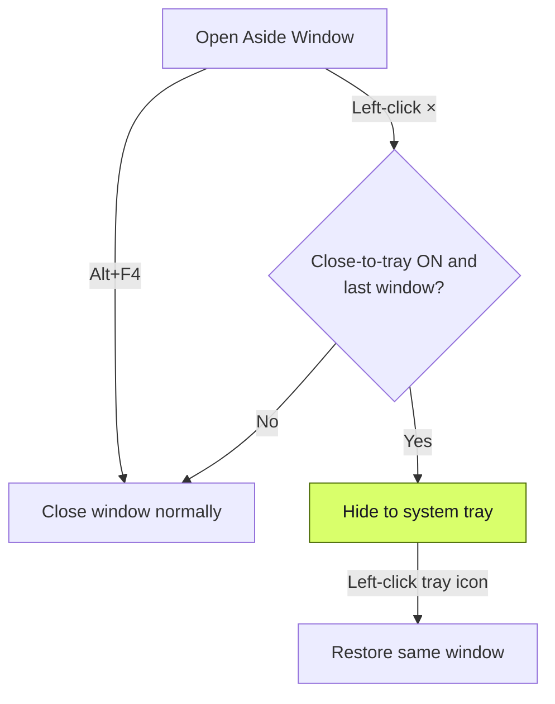

# Close to Tray Helper

> **[한국어 README 보기](README.ko.md)** · **[Visual Guide (한국어)](docs/VISUAL-GUIDE.md)** · **[Security Policy](SECURITY.md)** · **[Latest Release](https://github.com/Technoetic/close-to-tray-helper/releases/latest)**

<picture>
  <source media="(prefers-reduced-motion: reduce)" srcset="docs/visuals/hero.png">
  
</picture>

**Unofficial Windows helper that keeps the Aside browser running in the system tray while CLI automation works.** Left-clicking `×` on the last window hides it from the taskbar without terminating the browser or its daemon; left-clicking the tray icon restores the same window.

[Download Latest Release](https://github.com/Technoetic/close-to-tray-helper/releases/latest) · [Read `close-to-tray.ps1`](close-to-tray.ps1) · [Read `SECURITY.md`](SECURITY.md)

## Quick Install (Windows 10 / 11)

**Requirements:** Windows 10 or 11 (64-bit), installed Aside browser, built-in 64-bit Windows PowerShell 5.1, .NET Framework 4.x, and Windows Script Host. (32-bit PowerShell cannot inspect 64-bit browser processes.)

1. Download **`close-to-tray-helper-0.3.0-windows.zip`** (slim package, ~68 KB — excludes repo docs/visuals) and optional **`SHA256SUMS.txt`** from [Latest Release](https://github.com/Technoetic/close-to-tray-helper/releases/latest), then extract the ZIP.
2. Double-click **`install.cmd`** (or run `.\install.cmd` in PowerShell):
   - Installs the tray helper and uninstaller to `%LOCALAPPDATA%\CloseToTrayHelper\app`.
   - Automatically installs the `aside-repl` skill **only** for detected AI coding agents (Antigravity, Claude Code, Codex) — never creates folders for agents you do not use.
   - Pass **`-AppOnly`** (or `-SkipSkills`) to install only the tray helper, **`-AllHosts`** to install skills for all three agents, or **`-Restart`** to automatically restart a running helper during upgrade.
3. Launch the helper via `Win+R` (on Windows 11, check **Show hidden icons (`^`)** next to the clock):

```text
%LOCALAPPDATA%\CloseToTrayHelper\app\close-to-tray-launch.vbs
```

> **First test:** Open one Aside window, click its top-right `×`, then left-click the tray icon — the exact same window returns. To actually exit the browser, press `Alt+F4` on the last window.

### Uninstall

Run **`%LOCALAPPDATA%\CloseToTrayHelper\app\uninstall.cmd`** (or `.\uninstall.cmd` from the release folder). It stops a running helper (restoring hidden windows first), removes the Startup shortcut, verifies SHA-256 manifests before removing managed files, preserves any extra files you added, and refuses to delete locally edited files unless `-Force` is passed. Use `-KeepPrefs` to keep `prefs.json`.

## Optional `aside-repl` Skill (Antigravity · Claude Code · Codex)

All three hosts share the same [skill and runner](.agents/skills/aside-repl/SKILL.md). Once installed, open a new conversation and ask: **"Read the first heading of https://github.com/Technoetic/close-to-tray-helper README."**

| Tool | Trigger | Default User Skill Path |
|---|---|---|
| Antigravity (`agy`) | `/aside-repl` | `%USERPROFILE%\.gemini\config\skills\aside-repl` |
| Claude Code | `/aside-repl` | `%USERPROFILE%\.claude\skills\aside-repl` |
| Codex | `$aside-repl` | `%USERPROFILE%\.agents\skills\aside-repl` |

Custom `CLAUDE_CONFIG_DIR` and `CODEX_HOME` paths (including symlinked/junctioned agent config directories) are respected automatically. [Antigravity skills](https://antigravity.google/docs/customization-discovery?tab=cli) · [Claude Code skills](https://code.claude.com/docs/en/skills) · [Codex skills](https://learn.chatgpt.com/docs/build-skills)

**Direct PowerShell run** (requires running Aside, `aside` on `PATH`, and Python 3; default `--timeout 120` seconds):

```powershell
$skill = Join-Path $env:USERPROFILE '.gemini\config\skills\aside-repl'
python "$skill\scripts\run_repl.py" "$skill\examples\readme-title.js"
```

Inspect the `stdout.txt` path reported in JSON to verify `{"heading":"Close to Tray Helper"}`. [View example](.agents/skills/aside-repl/examples/readme-title.js)

## How Close-to-Tray Decides



When two or more browser windows are open, clicking `×` closes that window normally. Minimizing (`-`) also moves the window to the tray.

### Hide Modes

| Mode (Tray Menu) | While Hidden | If Helper Process Is Force-Killed |
|---|---|---|
| **DeleteTab** (default, recommended) | Minimizes the window and removes its taskbar button (`ITaskbarList::DeleteTab`). | Relaunching the helper finds the minimized window cleanly. |
| **HideWindow** (experimental) | Hides the window with `SW_HIDE` (removed from taskbar and `Alt+Tab`). | A restarted helper cannot see previously `SW_HIDE` windows; restart the browser from Task Manager. |

Normal exit (tray menu or `-Stop`) and Windows logoff restore all hidden windows and unhook the mouse hook.

## Memory Restart (Shared-Memory Leak)

Some Aside builds (observed on `1.0.1116.2`) keep opening 128 KiB pagefile-backed shared-memory sections in the main browser process and never close them: about 60 per minute, roughly 10 GB of commit per day ([upstream report](https://github.com/at-inc/docs/issues/18)). That memory counts toward the Windows commit limit but appears in no process's private bytes, so Task Manager does not show it, and it is released only when the browser exits. Because this helper keeps the browser running for days, the leak can fill the commit limit, after which other programs fail with out-of-memory errors.

The helper therefore restarts the browser while you are away:

| Step | What happens |
|---|---|
| Measure (every 60 s) | Reads the largest `SharedCommitUsage` among the browser's processes (Windows 10 or 11 version 22H2 with the September 2023 update or later; on older versions the tray shows the value as unavailable). Processes are opened with `PROCESS_QUERY_LIMITED_INFORMATION`, and their memory is never read. The tray menu shows the value; the helper counts 1 GB as 1024³ bytes. |
| Decide | Restarts only when the value reaches **4 GB**, the browser has **one window and it is in the tray**, no Aside CLI process is running or has run in the last **15 minutes** (counted from the helper's own start at the earliest), nothing is full-screen and no presentation mode is on, the browser is **not playing or recording sound** (asked of Windows only when everything else says restart), and there has been no keyboard or mouse input for **10 minutes**. A hidden browser window counts too: with two or more windows a normal close would let the browser restore only the last one, so the helper does not restart then. |
| Close | Posts `WM_CLOSE` to the browser's windows (a normal close, never a forced kill) and waits up to 60 s for the browser process to exit, plus another 60 s when no window is left but the process is still shutting down. |
| Reopen | Starts the same browser executable that was running (the configured or detected `Aside.exe` if its path cannot be read) with `--restore-last-session`. The reopened window can appear for a moment before the helper minimizes it back to the tray (at most twice, so a window you bring back stays open). |

After a successful restart, automatic restarts pause for 1 hour; after a failed one, for 6 hours. These pauses, like the mark described under "keeps running without windows" below, are kept in memory only: a helper that has just started has none of them.

- **Restart now:** **브라우저 다시 시작 (메모리 정리)** in the tray menu, or `-RestartBrowser`, restarts at once, whatever the memory, idle time, sound or window state. A balloon explains a refusal: two or more browser windows, a hidden browser window (only quitting the browser frees its memory then), an Aside CLI process running, no browser running or no browser window, a start or restart already in progress (up to 30 minutes while a page prompt waits for an answer), or no executable to start the browser again (then nothing is closed). A window that was on screen comes back on screen.
- **A window that does not close** (for example a "Leave site?" prompt): the helper shows the window, tells you with a balloon and waits up to 30 minutes. If the browser closes within that time, because you chose Leave or closed the browser yourself, the helper starts it again. If you choose Cancel, the browser stays as it is, but for the rest of the 30 minutes closing it still reopens it and the immediate restart is unavailable; after 30 minutes the helper stops waiting and does not try again for 6 hours, and closing the browser after that does not reopen it. If you stop the helper while it waits, it does not reopen the browser either.
- **A browser that keeps running without windows** (for example a "keep running in the background" setting): the helper opens a window again, tells you with a balloon, and does not restart that browser process again automatically, because its memory was not released.
- **Stopping the helper during a restart:** while the browser is closed and not yet open again, the helper finishes the restart before it exits. The tray menu's exit item is unavailable then, and an exit request (`-Stop`, for example) takes effect once the browser is open again, about 2 minutes at most. `-Stop` itself returns at once, so wait until the helper has exited before you start it again; `install.ps1 -Restart` and `uninstall.ps1` wait up to 130 s and say so when it takes longer. The reopened window then shows normally, because no tray icon is left to keep it in. When Windows signs out or shuts down during a restart and confirms it within about 5 seconds, the browser is not started again; when the sign-out is cancelled, it is.
- **Warning balloon:** when the value reaches twice the threshold (8 GB with the defaults, also while automatic restart is off) and no restart can happen, a balloon suggests restarting from the menu, at most once an hour.
- **Settings in `prefs.json`:** `autoRestart` (JSON `true` or `false`; default `true`), `restartAtGB` (default `4`; `0` turns the memory trigger off; otherwise 0.5–1024), `restartAfterHours` (default `0` = off; otherwise 1–720: restart by browser uptime, for Windows versions where the memory value is unavailable), `restartIdleMinutes` (default `10`; 1–1440). The three numbers may also be written as strings such as `"6.5"`. A missing value, a value of another type or one outside its range falls back to the default without affecting the other keys. The helper reads the file when it starts and rewrites it when you change a setting from the tray menu, so edit it while the helper is stopped.
- **Verified** on Windows 11 (build 26300) with Aside `1.0.1116.2`: with one window in the tray, a restart started a new browser process within about a second, reopened the same 7 tabs, and the window was in the tray at every check during the next minute; the main browser process's shared commit went from 0.48 GB (the last 5-minute sample, 4½ minutes before the restart) to 0.12 GB (36 seconds after it). A restart request was refused while an Aside CLI command was running and while two windows were open. A stop request sent 0.2 s after a restart request made the helper exit only after the browser was open again (with no restart in progress it exits within about 70 ms). The code just before the last review fixes repeated the tray restart: a new browser process within about a second, the same 7 tabs, the window in the tray at every check during the next minute, and the program in front kept the foreground; a restart request sent while an Aside CLI process was running was refused. The final code did it once more with the same result for the process, the tabs and the tray (a blank tab left by an Aside CLI call that ended just before the restart did not come back); someone was using the PC during that run, so it does not show whether the foreground was kept.

<details>
<summary><strong>CLI Options & Startup Shortcut</strong></summary>

```powershell
# Run directly in current session (-STA required)
$helper = Join-Path $env:LOCALAPPDATA 'CloseToTrayHelper\app\close-to-tray.ps1'
powershell -NoProfile -ExecutionPolicy Bypass -STA -File "$helper"

# Optional: start automatically at Windows sign-in
powershell -NoProfile -ExecutionPolicy Bypass -File "$helper" -InstallStartup
```

| Option | Behavior |
|---|---|
| `-Mode DeleteTab` / `-Mode HideWindow` | Set and persist hide mode in `%LOCALAPPDATA%\CloseToTrayHelper\prefs.json`. |
| `-CloseToTray` / `-NoCloseToTray` | Enable or disable last-window `×` interception and persist. |
| `-StartAside` | Launch the browser when starting this helper instance. |
| `-Show` / `-Hide` / `-Toggle` / `-Stop` | Send IPC command to the running helper (`running` and `sent` report whether a listener received it). `-Stop` returns at once; during a browser restart the helper exits once the browser is open again. |
| `-InstallStartup` / `-UninstallStartup` | Create or remove `%APPDATA%\Microsoft\Windows\Start Menu\Programs\Startup\Close To Tray Helper.lnk`. |
| `-AsideExe <path>` / `-AsideUpScript <path>` | Override browser binary or optional launch helper script. A memory restart starts the executable that was running and uses `-AsideExe` only when that path cannot be read; it never runs the launch script. |
| `-PrefsPath <file>` / `-StartupDir <dir>` | Override settings file or Startup directory. |
| `-RestartBrowser` | Ask the running helper to restart the browser now (normal close, then reopen with `--restore-last-session`). |
| `-PolicyTest` | Check the restart decision table and how `prefs.json` is read; shows no window. |
| `-Restart` | Not an option of this script (`-Restart` belongs to `install.cmd`): prints a hint and exits with code 2 instead of being read as an abbreviation of `-RestartBrowser`. |
| `-SelfTest` / `-Json` | Run offline Win32 self-test / emit machine-readable JSON. |

Single-instance lock uses `Local\Close-To-Tray-Helper`.

</details>

## Close Button Detection & Safety Disclosures


Tab `×` buttons continue to close tabs normally. The helper monitors global left-clicks via `WH_MOUSE_LL`, first checks a bounded UI Automation cache for the rightmost top-corner window Close button (skipping web `Document` subtrees), and falls back to `WM_NCHITTEST` → `HTCLOSE`. Zero keyboard hooking, zero click logging, zero network calls, zero DLL injection. See [SECURITY.md](SECURITY.md) for the full threat model.

- **Mouse stutter on hung browser:** `WH_MOUSE_LL` runs on the helper UI thread. Uncheck **닫기(×) 클릭 시 트레이로 숨기기** in the tray menu to unhook immediately.
- **AV / EDR warnings:** Unsigned hidden PowerShell, `WH_MOUSE_LL`, and Startup shortcuts can trigger security alerts. Review the source and your organization policy first.
- **Memory restart closes and reopens the browser:** With the default settings the helper may restart the browser while you are away, when its one window is in the tray, it plays no sound and there has been no input for 10 minutes (see [Memory Restart](#memory-restart-shared-memory-leak)). It asks the window to close normally and never kills a process, so whatever a normal close would lose (for example unsaved text in a web form) is lost here too. Turn it off from the tray menu.
- **Test environment & unofficial status:** Verified on Windows 11 with Aside `1.0.1116.2`. On the test PC, Aside registered no native tray icon and closing the last window stopped `aside-daemon.exe`. Aside's public docs checked on 2026-11-21 did not document a hide-to-tray option, though changelogs mention Windows tray menus and `keep-tasks-running`; behavior on other versions may differ. Unofficial project, not affiliated with or endorsed by the makers of Aside.

## Tests

```powershell
# Default suite (32 tests: PowerShell syntax/ASCII, IPC, Startup shortcut, restart decision table,
# prefs validation, least-privilege and never-kill checks, smart installer & uninstaller,
# run_repl.py timeout/guards, deterministic slim ZIP)
python -m unittest discover -s tests -v

# Full suite including live desktop WinForms hook/UIA self-test (33 tests)
$env:CLOSE_TO_TRAY_SELFTEST = '1'
python -m unittest discover -s tests -v
```

Tests that run the uninstaller or the ZIP install round trip skip themselves while a Close to Tray Helper runs in the same session, because the uninstaller would stop it; CI runs them all.

## Changelog & License

- **[v0.3.0 · 2026-11-25](https://github.com/Technoetic/close-to-tray-helper/releases/tag/v0.3.0)** — Added memory restart: the helper measures the browser's leaked shared memory (`SharedCommitUsage`) and, at 4 GB, with the browser's one window in the tray, no Aside CLI activity for 15 minutes, nothing full-screen, no sound from the browser and 10 idle minutes, closes the browser normally and reopens it with `--restore-last-session` (tray menu toggle, immediate restart item, `-RestartBrowser`, `-PolicyTest`, four new `prefs.json` keys). An exit asked for while the browser is closed for a restart takes effect once it is open again; `install.ps1 -Restart` and `uninstall.ps1` wait up to 130 s for that and warn when the helper is still running. Fixed `prefs.json` reading: a file without a `mode` key no longer drops every other setting.
- [v0.2.1 · 2026-11-22](https://github.com/Technoetic/close-to-tray-helper/releases/tag/v0.2.1) — Added Windows GitHub Actions CI, `SECURITY.md`, deterministic slim Windows release ZIP + `SHA256SUMS.txt`, smart agent-detecting installer (`-AppOnly`/`-SkipSkills`/`-AllHosts`/`-Restart`, symlinked agent config support, running-instance notice), `uninstall.cmd`/`uninstall.ps1`, `run_repl.py` timeout & unit tests, fixed `-InstallStartup -Json` `icon_exe`, IPC listener detection, and 3-tooltip self-test check, synced `docs/VISUAL-GUIDE.md` & diagrams, and added bilingual English/Korean READMEs.
- [v0.2.0 · 2026-11-21](https://github.com/Technoetic/close-to-tray-helper/releases/tag/v0.2.0) — Added Windows bundle installer and shared `aside-repl` skill for Antigravity, Claude Code, and Codex.
- [v0.1.1 · 2026-11-21](https://github.com/Technoetic/close-to-tray-helper/releases/tag/v0.1.1) — Neutral Windows icons, `[close-to-tray]` output prefix, and evidence-scoped README.
- [v0.1.0 · 2026-11-21](https://github.com/Technoetic/close-to-tray-helper/releases/tag/v0.1.0) — Initial public release.

[MIT License](LICENSE)
