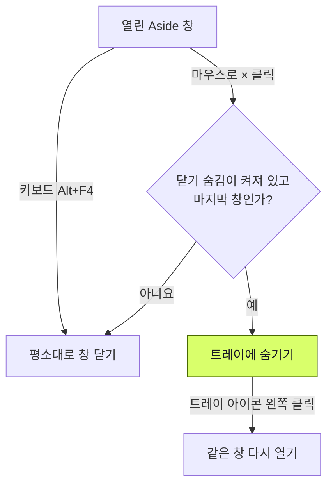

# Close to Tray Helper

<picture>
  <source media="(prefers-reduced-motion: reduce)" srcset="docs/visuals/hero.png">
  
</picture>

**Aside에서 명령줄 자동화를 돌리는 동안 브라우저 창을 치우고 싶을 때 쓰는 Windows 도우미입니다.** 마지막 창의 `×`를 마우스 왼쪽으로 누르면 작업 표시줄에서 창이 사라지고 브라우저는 계속 실행됩니다. 다시 보고 싶을 때는 시계 옆 트레이 아이콘을 한 번 클릭하세요.

[최신 릴리스 받기](https://github.com/Technoetic/close-to-tray-helper/releases/latest) · [동작을 그림으로 보기](docs/VISUAL-GUIDE.md) · [실행 스크립트 읽기](close-to-tray.ps1)

## 도우미와 스킬 함께 설치하기

**준비물**은 Windows 10 또는 11, 설치된 Aside AI 브라우저, Windows 기본 64비트 PowerShell 5.1, .NET Framework 4.x, Windows Script Host입니다. 32비트 PowerShell로는 64비트 브라우저 프로세스를 확인할 수 없습니다.

1. [최신 릴리스](https://github.com/Technoetic/close-to-tray-helper/releases/latest)에서 **Source code (zip)**을 받아 폴더 전체를 압축 해제합니다.
2. 폴더의 **`install.cmd`**를 두 번 클릭합니다. 도우미와 `aside-repl`이 현재 Windows 사용자 계정에 함께 설치됩니다. Git으로 복제했다면 저장소 폴더에서 `.\install.cmd`를 실행해도 됩니다.
3. 도우미를 시작하려면 `Win+R`을 누르고 아래 경로를 입력합니다. Windows 11에서는 시계 옆 **숨겨진 아이콘 표시(∧)**에서 트레이 아이콘을 찾을 수 있습니다.

```text
%LOCALAPPDATA%\CloseToTrayHelper\app\close-to-tray-launch.vbs
```

새 릴리스로 업데이트할 때도 같은 설치 파일을 실행하세요. 직접 설치한 동명 스킬이나 수정한 설치 파일이 있으면 설치기가 충돌 경로를 표시합니다. 해당 파일을 따로 보관한 뒤 재시도할 수 있습니다.

> **처음 써보기** — Aside 창 하나를 열고 오른쪽 위 `×`를 클릭한 뒤, 트레이 아이콘을 왼쪽 클릭해 보세요. 같은 창이 돌아옵니다. 브라우저를 실제로 끝내려면 마지막 창에서 `Alt+F4`를 누르세요.

## 트레이에 둔 브라우저로 README 제목 읽기

Antigravity(agy), Claude Code, Codex는 같은 [스킬과 실행 예제](.agents/skills/aside-repl/SKILL.md)를 사용합니다. 설치한 뒤 원하는 프로젝트에서 새 대화를 열고, 아래 호출 뒤에 **“https://github.com/Technoetic/close-to-tray-helper 에서 README의 첫 제목을 읽어 줘.”**라고 적어 보세요.

| 도구 | 호출 | 사용자별 기본 스킬 폴더 |
|---|---|---|
| Antigravity (agy) | `/aside-repl` | `%USERPROFILE%\.gemini\config\skills\aside-repl` |
| Claude Code | `/aside-repl` | `%USERPROFILE%\.claude\skills\aside-repl` |
| Codex | `$aside-repl` | `%USERPROFILE%\.agents\skills\aside-repl` |

`CLAUDE_CONFIG_DIR` 또는 `CODEX_HOME`을 지정한 계정에서는 해당 설정 폴더 아래의 `skills\aside-repl`에 설치합니다. [Antigravity 스킬](https://antigravity.google/docs/customization-discovery?tab=cli) · [Claude Code 스킬](https://code.claude.com/docs/en/skills) · [Codex 스킬](https://learn.chatgpt.com/docs/build-skills)

**PowerShell에서 직접** 실행할 때는 설치된 스킬 폴더 중 하나를 사용하세요. 이 예제에는 실행 중인 Aside, PATH에 등록된 `aside` CLI, Python 3가 필요합니다.

```powershell
$skill = Join-Path $env:USERPROFILE '.gemini\config\skills\aside-repl'
python "$skill\scripts\run_repl.py" "$skill\examples\readme-title.js"
```

실행기가 알려 주는 `stdout.txt`를 열면 `{"heading":"Close to Tray Helper"}`를 확인할 수 있습니다. 예제는 자신이 연 탭만 닫습니다. [예제 코드 보기](.agents/skills/aside-repl/examples/readme-title.js)

## 어느 클릭이 트레이로 갈까?



창이 두 개일 때 `×`를 누르면 클릭한 창만 닫힙니다. `×` 대신 **최소화(－)**를 눌러도 도우미가 해당 창을 트레이로 보냅니다. 숨겨진 Chromium 창은 그리기 빈도가 낮아지므로, 애니메이션을 눈으로 확인할 때는 창을 다시 여세요.

### 숨김 방식 고르기

| 트레이 메뉴에서 고를 모드 | 창이 숨겨진 동안 | 도우미가 갑자기 종료되면 |
|---|---|---|
| **작업 표시줄만 숨기기** · `DeleteTab` · 기본값 | 브라우저 창을 최소화하고 실행 중인 창의 작업 표시줄 버튼을 제거합니다. | 도우미를 다시 켜면 최소화된 창을 찾을 수 있습니다. |
| **완전 숨기기** · `HideWindow` · 실험 기능 | 창에 `SW_HIDE`를 적용합니다. 작업 표시줄과 `Alt+Tab`에서 모두 사라집니다. | 숨겨진 창을 다시 찾지 못할 수 있습니다. 이때는 작업 관리자에서 브라우저를 종료한 뒤 다시 시작해야 합니다. |

평소에는 **작업 표시줄만 숨기기**를 권장합니다. 브라우저를 작업 표시줄에 고정해 뒀다면 고정 아이콘은 계속 보입니다. 도우미를 메뉴나 `-Stop`으로 정상 종료하거나 Windows에서 로그아웃하면 숨겼던 창의 작업 표시줄 버튼을 복원하고 마우스 훅을 해제합니다.

<details>
<summary><strong>트레이 아이콘을 오른쪽 클릭하면 나오는 메뉴 9개</strong></summary>

| 메뉴 | 사용 시점 |
|---|---|
| 브라우저 창 열기 | 숨겨 둔 창을 다시 볼 때 |
| 트레이로 즉시 숨기기 | 열려 있는 창을 바로 치울 때 |
| 브라우저 시작 (트레이로) | 브라우저를 새로 시작해 트레이에 둘 때 |
| 숨김 방식: 작업 표시줄만 숨기기 (권장) | 기본 최소화 상태를 유지할 때 |
| 숨김 방식: 완전 숨기기 (Alt+Tab 포함) | 창 전환 목록에서도 숨길 때 |
| 닫기(×) 클릭 시 트레이로 숨기기 | 마지막 창의 닫기 동작을 전환할 때 |
| Windows 로그인 시 자동 실행 | 다음 로그인부터 도우미를 시작할 때 |
| 도우미 시작 시 브라우저도 자동 시작 | 도우미와 브라우저를 함께 시작할 때 |
| 트레이 도우미 종료 (브라우저 창 복원) | 숨긴 창을 복원하고 도우미를 끝낼 때 |

</details>

## 설치 환경에 맞게 설정하기

PowerShell에서 직접 실행할 때는 `-STA`를 붙입니다. 로그인할 때마다 실행하려면 아래 두 번째 명령을 한 번 사용하세요.

```powershell
# 현재 세션에서 직접 실행
$helper = Join-Path $env:LOCALAPPDATA 'CloseToTrayHelper\app\close-to-tray.ps1'
powershell -NoProfile -ExecutionPolicy Bypass -STA -File "$helper"

# 선택 사항: Windows 로그인 시 자동 실행
powershell -NoProfile -ExecutionPolicy Bypass -File "$helper" -InstallStartup
```

숨김 방식, 닫기 버튼 처리, 브라우저 동시 시작 여부는 `%LOCALAPPDATA%\CloseToTrayHelper\prefs.json`에 저장됩니다. **Windows 로그인 시 자동 실행**은 시작프로그램 폴더의 `Close To Tray Helper.lnk`로 관리합니다. 도우미 폴더를 옮겼다면 `-InstallStartup`을 다시 실행하세요.

<details>
<summary><strong>명령줄 옵션 전체 보기</strong></summary>

| 옵션 | 동작 |
|---|---|
| `-Mode DeleteTab` / `-Mode HideWindow` | 숨김 방식을 지정하고 저장합니다. |
| `-CloseToTray` / `-NoCloseToTray` | 마지막 창의 닫기 버튼 처리를 켜거나 끄고 저장합니다. |
| `-StartAside` | 이번 도우미 실행과 함께 브라우저를 시작합니다. |
| `-Show` / `-Hide` / `-Toggle` | 실행 중인 도우미에 창 표시·숨김·전환 명령을 보냅니다. |
| `-Stop` | 숨긴 창을 복원하고 실행 중인 도우미를 종료합니다. |
| `-InstallStartup` / `-UninstallStartup` | 로그인용 바로 가기를 만들거나 제거합니다. |
| `-AsideExe <경로>` | 사용할 브라우저 실행 파일을 지정합니다. |
| `-AsideUpScript <경로>` | 브라우저 시작용 스크립트를 지정합니다. 기본 위치는 도우미 옆의 `aside-up.ps1`입니다. 스크립트가 없으면 브라우저 실행 파일을 직접 시작합니다. |
| `-PrefsPath <파일>` / `-StartupDir <폴더>` | 별도 설정 파일이나 시작프로그램 폴더를 사용합니다. |
| `-SelfTest` | 오프라인 자체 시험을 실행합니다. |
| `-Json` | 결과를 JSON으로 출력합니다. |

`-AsideExe`나 환경 변수 `ASIDE_EXE`에 경로를 지정하면 그 경로만 사용합니다. 둘 다 생략하면 `%ProgramFiles%`, `%ProgramFiles(x86)%`, `%LOCALAPPDATA%` 아래의 기본 설치 폴더를 찾습니다. 시작 스크립트와 실행 파일을 모두 찾지 못하면 메뉴에서 브라우저 시작을 눌러도 실행되지 않습니다.

도우미는 이름 있는 뮤텍스 `Local\Close-To-Tray-Helper`로 한 번만 실행됩니다. 이미 실행 중이면 두 번째 실행은 끝나므로 `-Mode` 같은 시작 옵션으로 기존 설정을 바꿀 때는 트레이 메뉴를 이용하거나 `-Stop` 후 다시 시작하세요.

</details>

## 닫기 버튼을 어떻게 구분하나?


탭에 붙은 작은 `×`는 탭을 닫는 데 계속 쓸 수 있습니다. 도우미가 찾는 것은 **창 전체의 오른쪽 위 닫기 버튼**입니다.

도우미는 Windows 전역의 마우스 왼쪽 클릭을 살핍니다. 먼저 클릭한 위치가 UI Automation에 저장된 마지막 창의 닫기 버튼 영역에 들어가는지 확인합니다. 여기서 일치하지 않으면 Windows에 그 지점이 닫기 버튼인지 묻습니다(`WM_NCHITTEST` → `HTCLOSE`). 조건이 맞으면 누름과 뒤따르는 뗌을 처리하고 창을 숨깁니다. 키보드 입력을 후킹하거나 클릭을 기록·전송하는 기능은 없습니다. 도우미 자체는 네트워크에 연결하지 않으며 브라우저 파일을 수정하거나 브라우저에 코드를 주입하지 않습니다.

| 이런 현상이 보이면 | 이렇게 대응하세요 |
|---|---|
| 브라우저가 멈출 때 마우스도 잠시 느려짐 | 마우스 훅(`WH_MOUSE_LL`)이 도우미 UI 스레드에서 실행됩니다. 트레이 메뉴의 **닫기(×) 클릭 시 트레이로 숨기기**를 끄면 훅이 해제됩니다. |
| 브라우저 업데이트 뒤 닫기 버튼 감지가 달라짐 | 브라우저의 창 구조가 바뀌면 감지가 깨질 수 있습니다. 같은 메뉴에서 해당 기능을 끄세요. |
| 백신이나 회사 보안 프로그램이 경고함 | 숨김 PowerShell, 전역 마우스 훅, 시작프로그램 바로 가기가 경고 대상일 수 있습니다. 실행 전에 스크립트와 조직의 사용 정책을 확인하세요. |

**시험 환경**은 Windows 11과 Aside `1.0.1116.2`입니다. 이 PC에서는 Aside가 자체 트레이 아이콘을 등록한 기록이 없었고, 마지막 창을 닫으면 백그라운드 데몬도 끝나 CLI 자동화가 중단됐습니다. 2026년 11월 21일 확인한 브라우저 공식 문서에는 트레이로 숨기는 옵션 설명이 없었습니다. 변경 기록에는 Windows 트레이 메뉴와 `keep-tasks-running` 설정이 언급되어 있어, 다른 버전이나 상황에서의 동작은 달라질 수 있습니다. 이 프로젝트는 Aside 제작사와 제휴·후원·지원 관계가 없는 비공식 도구입니다.

## 동작을 그림으로 더 보기

[**시각 도감 열기 →**](docs/VISUAL-GUIDE.md) 트레이에서 숨긴 창이 돌아오기까지의 메시지, 마지막 창 판정, 겹친 창에서의 클릭 처리, 실제 시험 좌표를 그림으로 살펴볼 수 있습니다.

<details>
<summary><strong>시험 명령과 제거 방법</strong></summary>

Windows에서 기본 시험은 파일 구성, PowerShell 문법, 실행기와 임시 디렉터리의 시작프로그램 바로 가기를 검사합니다.

```powershell
python -m unittest discover -s tests -v
```

바탕 화면 시험은 내장 C# 제어기를 컴파일하고 작은 최상위 시험 창 세 개를 잠시 띄워 클릭 감지, 여러 창의 동작과 훅 해제를 검사합니다. 이 시험까지 포함하려면 다음을 실행하세요.

```powershell
$env:CLOSE_TO_TRAY_SELFTEST = '1'
python -m unittest discover -s tests -v
```

**제거**할 때는 먼저 숨긴 창을 복원하고 로그인 바로 가기를 해제합니다.

```powershell
$helper = Join-Path $env:LOCALAPPDATA 'CloseToTrayHelper\app\close-to-tray.ps1'
powershell -NoProfile -ExecutionPolicy Bypass -File "$helper" -Stop
powershell -NoProfile -ExecutionPolicy Bypass -File "$helper" -UninstallStartup
```

도우미와 설정까지 지우려면 `%LOCALAPPDATA%\CloseToTrayHelper`에서 보관할 파일을 옮긴 후 해당 폴더를 삭제하세요. 스킬도 제거하려면 설치가 끝날 때 표시된 각 `aside-repl` 폴더에서 `.close-to-tray-bundle.json`의 파일 목록을 확인하고, 목록의 파일과 이 JSON 파일을 삭제하세요.

</details>

## 변경 이력과 라이선스

- [v0.2.0 · 2026-11-21](https://github.com/Technoetic/close-to-tray-helper/releases/tag/v0.2.0) — Windows 설치 한 번으로 트레이 도우미와 Antigravity·Claude Code·Codex용 `aside-repl`을 함께 설치합니다.

- [v0.1.1 · 2026-11-21](https://github.com/Technoetic/close-to-tray-helper/releases/tag/v0.1.1) — 트레이와 바로 가기에 Windows 표준 아이콘을 사용합니다. 콘솔 출력은 `[close-to-tray]`로 시작합니다. 브라우저 자체 트레이 기능에 관해 확인한 범위를 문서화했습니다.
- [v0.1.0 · 2026-11-21](https://github.com/Technoetic/close-to-tray-helper/releases/tag/v0.1.0) — 첫 공개 버전입니다.

[MIT 라이선스 전문](LICENSE)
