# 트레이 동작 도감

[한국어 README로 돌아가기](../README.ko.md) · [English README](../README.md)

트레이에 아이콘이 보이지 않거나 창의 `×`가 예상과 다르게 동작한다면 해당 그림을 펼쳐 보세요. 동작과 수치는 [v0.2.1 실행 코드](../close-to-tray.ps1), [설치·제거기](../install.ps1), [Windows 테스트](../tests/)를 기준으로 했습니다.

## 트레이 사용법

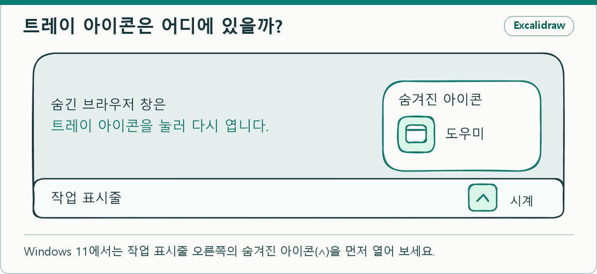

Windows 11 작업 표시줄에서 숨겨진 아이콘을 펼치면 도우미가 보입니다. 아이콘을 왼쪽 클릭하면 브라우저 창으로 돌아갑니다. *(Excalidraw)*

오른쪽 클릭 메뉴 읽기

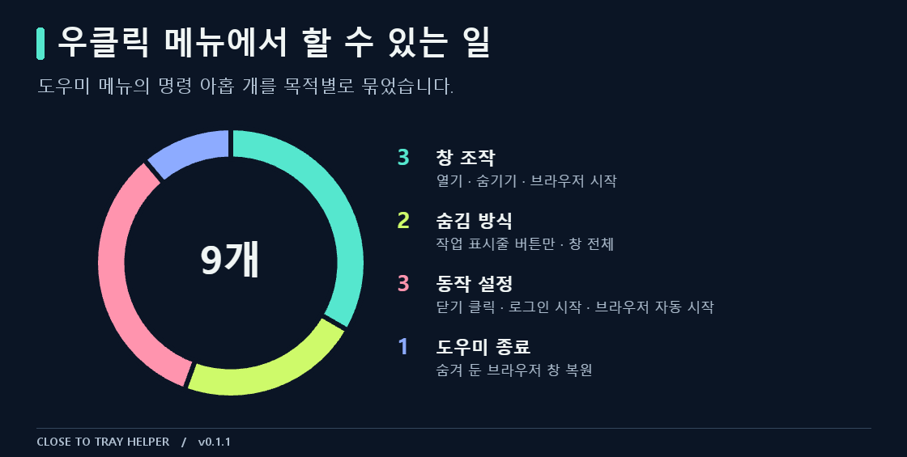

메뉴 아홉 개를 동작별로 묶었습니다. 아이콘에서 바로 창을 열 수 있고, 자주 쓸 숨김 방식을 여기서 바꿀 수 있습니다. *(Chart.js)*

메뉴가 회색일 때

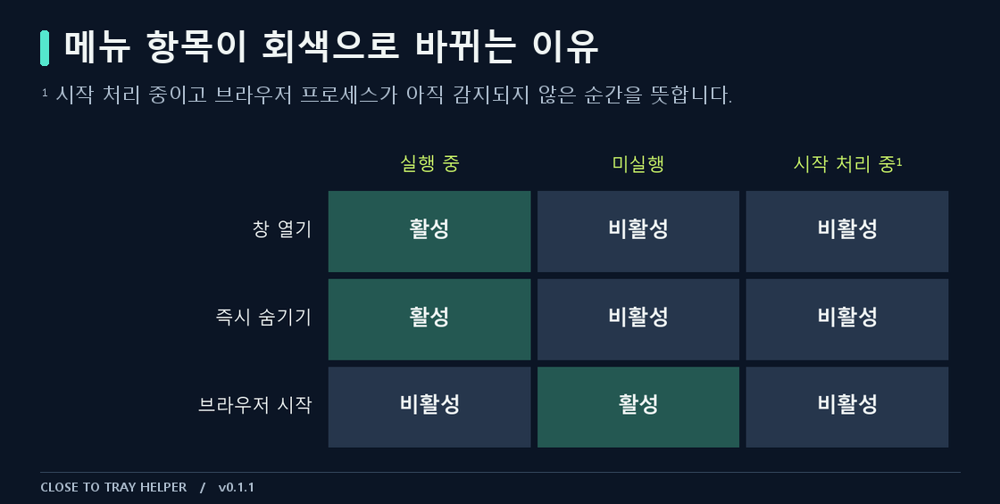

브라우저가 실행 중이면 열기와 숨기기가 활성화됩니다. 브라우저 시작 명령은 실행 중인 브라우저가 없고 기동 작업도 진행 중이지 않을 때 활성화됩니다. *(seaborn)*

아이콘에 마우스를 올려 상태 확인하기

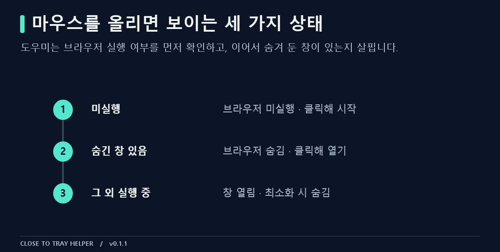

도우미는 브라우저 실행 여부를 먼저 보고, 실행 중이면 숨긴 창이 있는지 확인해 안내 문구를 고릅니다. *(Observable Plot)*

두 번 눌러도 바로 되돌아가지 않는 이유

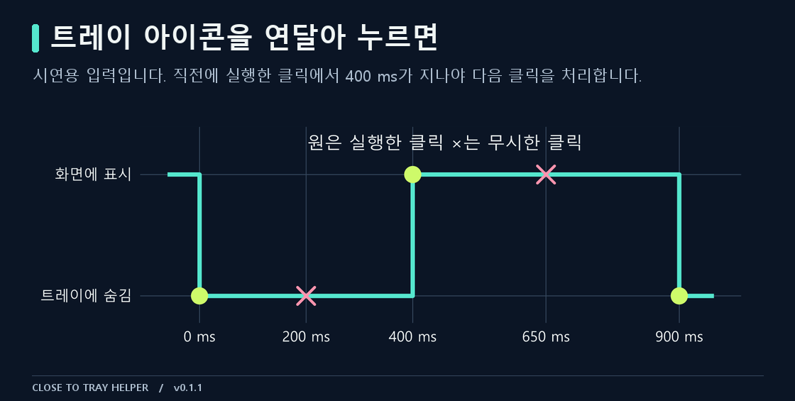

직전에 받아들인 트레이 왼쪽 클릭 후 400ms가 지나기 전에 다시 누르면 두 번째 클릭을 건너뜁니다. 그림의 클릭 시각은 이 규칙을 설명하기 위한 예시입니다. *(ggplot2)*

## 시작과 설정

처음 시작하는 세 줄

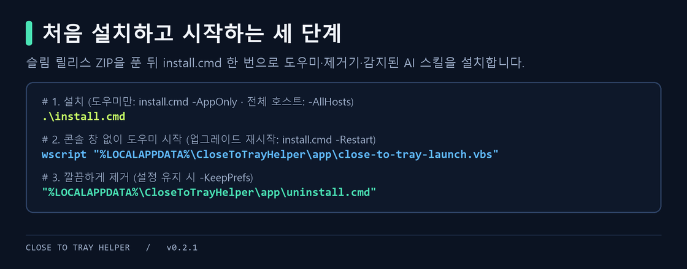

슬림 릴리스 ZIP을 푼 뒤 `install.cmd`로 설치하고 VBS 실행기로 도우미를 시작하는 흐름입니다. AI 도구 스킬을 빼고 도우미만 설치할 때는 `-AppOnly`, 제거할 때는 `uninstall.cmd`를 사용합니다. 자세한 옵션은 [한국어 README 설치 안내](../README.ko.md#도우미와-스킬-함께-설치하기)를 참고하세요.

검은 콘솔 창이 뜨지 않는 이유

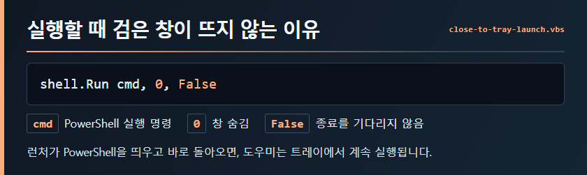

실제 VBScript의 shell.Run 인수입니다. 두 번째 인수 0은 창을 숨기고, 세 번째 인수 False는 PowerShell이 끝날 때까지 실행기가 기다리지 않게 합니다. *(highlight.js)*

Aside 실행 파일을 찾는 순서

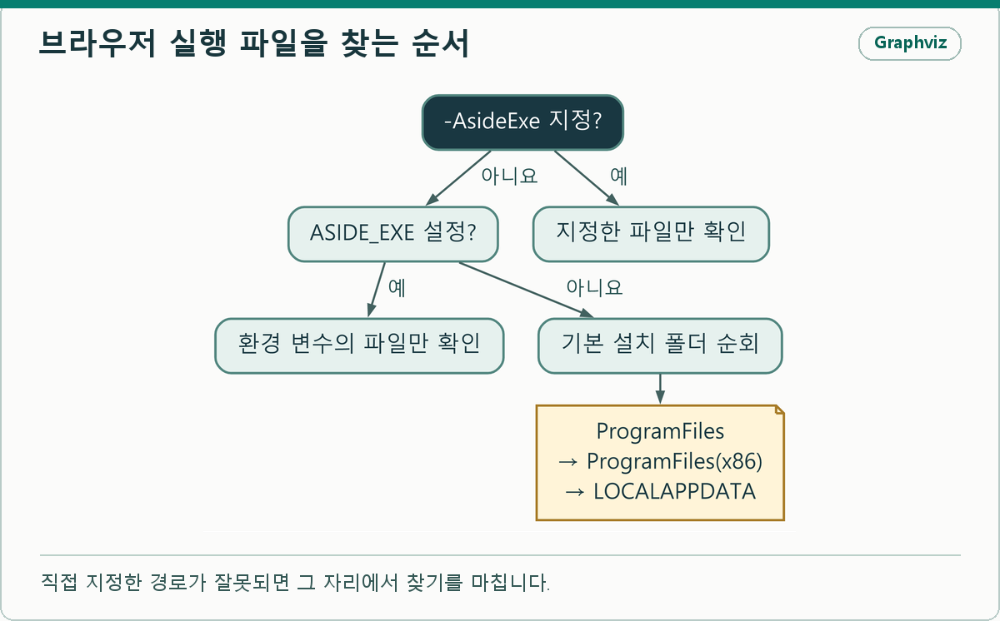

명시한 실행 파일이나 환경 변수의 경로가 우선합니다. 둘 다 비어 있을 때만 기본 설치 폴더를 순서대로 확인합니다. *(Graphviz)*

설정은 어디에 남을까?

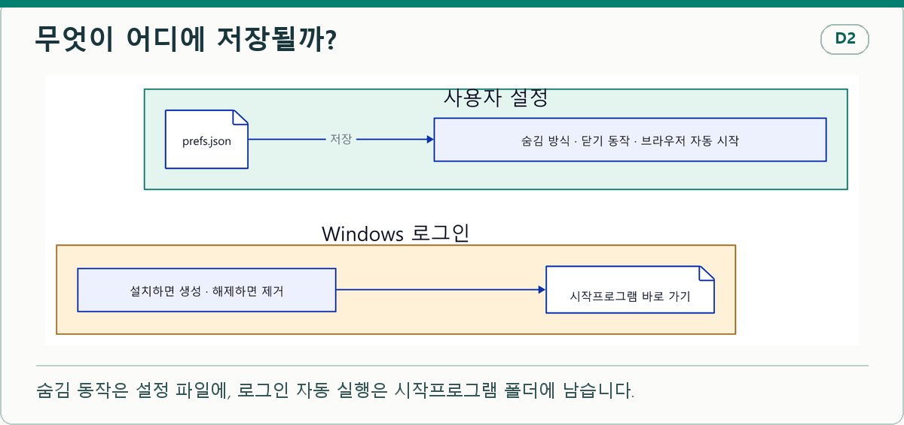

숨김 방식과 브라우저 자동 시작 설정은 prefs.json에, Windows 로그인 때 도우미를 켤지는 시작프로그램 바로 가기에 남습니다. *(D2)*

## 닫기 버튼 판정

어떤 창이 추적 대상일까?

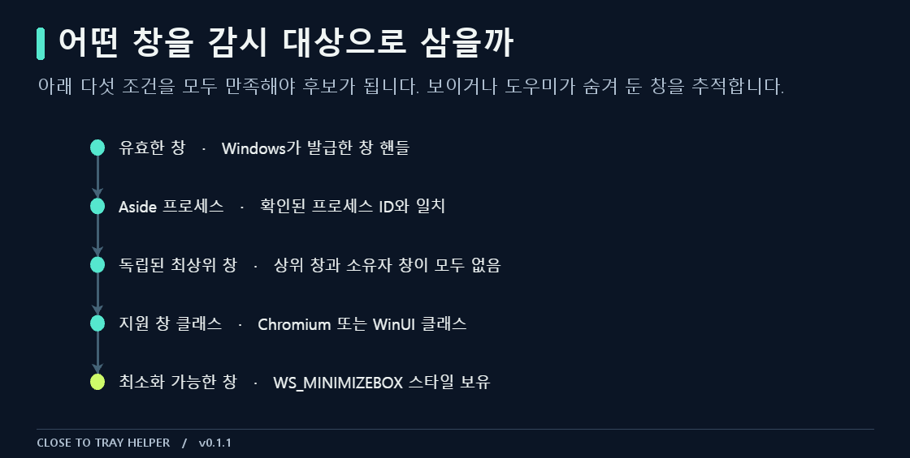

프로세스와 최상위 창 조건을 통과한 창을 추적합니다. 여기서 정한 대상이 ‘마지막 창’ 판단의 기준입니다. *(Apache ECharts)*

탭의 ×와 창의 × 구분하기

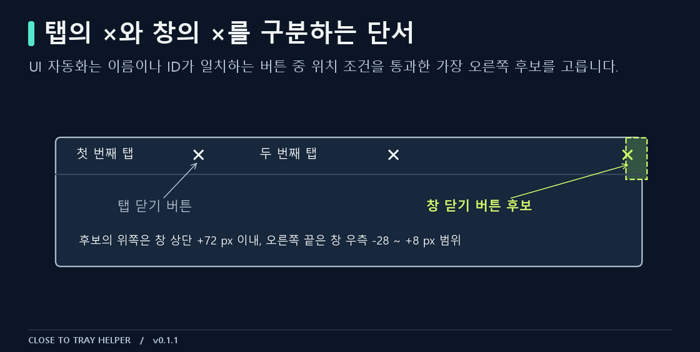

UI Automation은 버튼 이름과 창 오른쪽 끝의 위치를 함께 살핍니다. 도식의 탭과 버튼은 위치 관계를 설명하는 예시입니다. *(Matplotlib)*

오른쪽 위 어느 범위까지 확인할까?

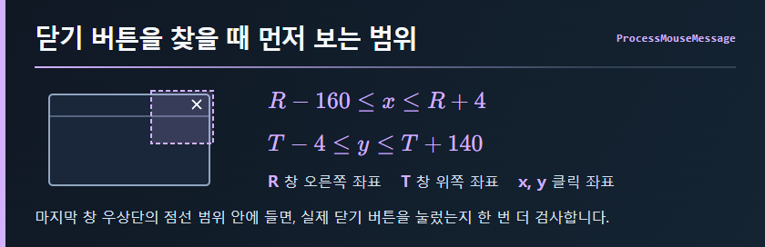

R은 창의 오른쪽 좌표, T는 위쪽 좌표입니다. 클릭이 그림의 범위에 들면 저장한 닫기 버튼 영역이나 Windows의 위치 판정으로 다시 확인합니다. *(KaTeX)*

버튼을 누른 뒤 떼면 어디로 갈까?

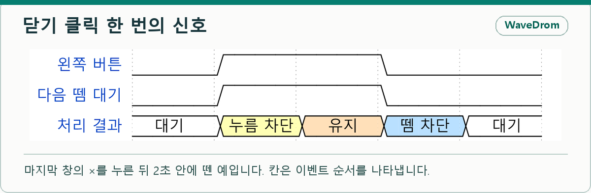

마지막 창의 × 누름을 처리하면 뒤따르는 왼쪽 버튼 뗌도 대기 기한 안에서 한 번 처리합니다. 그림은 이벤트 순서이며 실제 소요 시간은 각 칸의 폭으로 표시하지 않습니다. *(WaveDrom)*

## 명령 전달과 복원

작은 도우미와 Windows의 역할

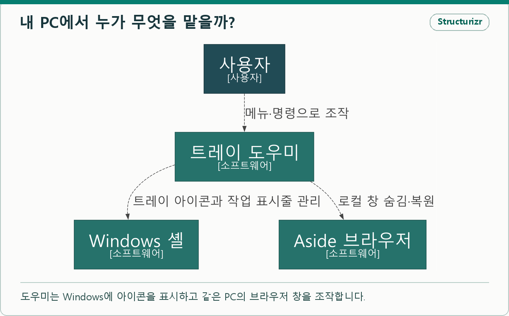

도우미는 트레이와 작업 표시줄을 Windows 셸을 통해 다루고, Aside의 최상위 창을 숨기거나 복원합니다. *(Structurizr)*

아이콘·메뉴·명령줄이 만나는 곳

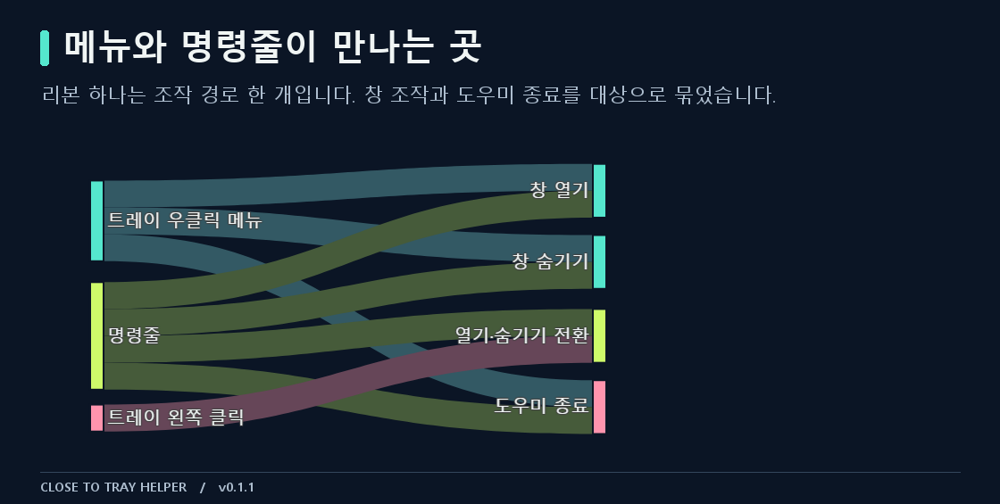

사용자가 어느 입력 경로를 택했는지에 따라 표시·숨김·전환·도우미 종료 동작으로 이어집니다. *(Plotly)*

실행 중인 도우미에 명령 보내기

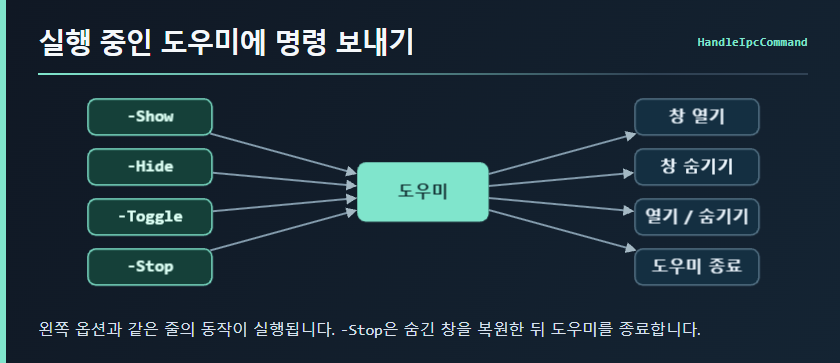

명령줄의 네 옵션을 받은 도우미가 각각 창 표시·숨김·전환·종료 처리를 선택합니다. -Stop은 도우미 종료 요청입니다. *(Cytoscape.js)*

명령을 보낸 뒤 Windows가 하는 일

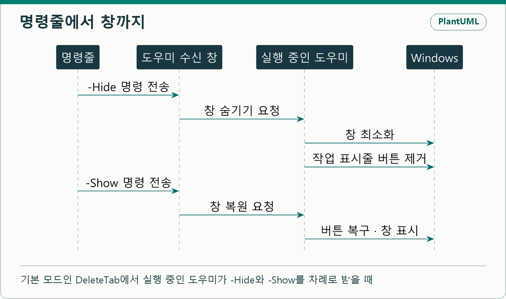

기본 모드에서 -Hide 요청으로 창을 최소화하고 작업 표시줄 버튼을 제거합니다. -Show를 받으면 작업 표시줄 버튼과 창을 복원합니다. *(PlantUML)*

다시 열 때 어떤 창들을 찾을까?

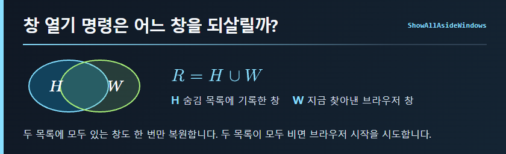

창 열기 명령은 숨겨 두었다고 기록한 창과 지금 발견한 창을 합칩니다. 양쪽에서 찾은 같은 창은 한 번만 처리합니다. *(MathJax)*

## 시험과 문제 해결

코드에 적힌 대기 시간 읽기

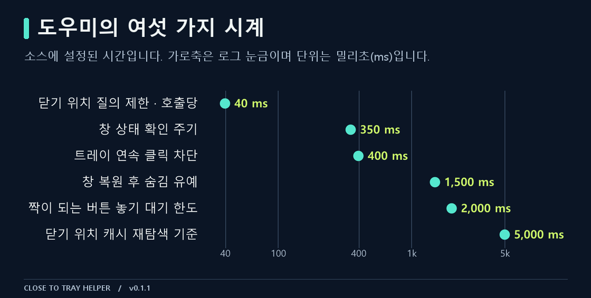

각 점은 구현에 명시된 타이머 주기·대기 기한입니다. 예를 들어 350ms는 상태 확인 주기이고, 400ms는 트레이 연속 클릭을 거르는 기준입니다. *(Vega-Lite)*

기본 시험에서 확인하는 것

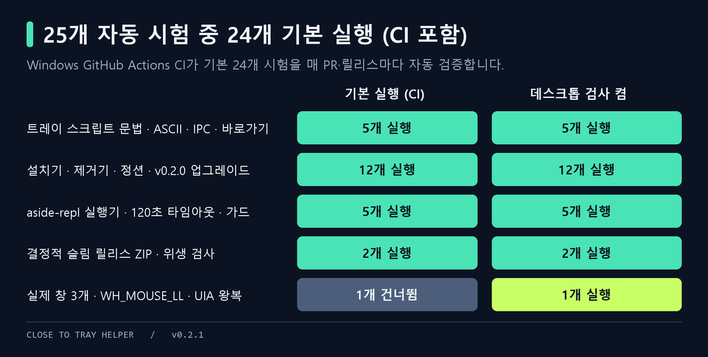

네 개 테스트 모듈의 총 25개 시험 중 24개가 기본 실행 대상이며(GitHub Actions Windows CI 자동 검증), 실제 시험 창과 마우스 훅을 쓰는 데스크톱 자체 시험 1개는 `CLOSE_TO_TRAY_SELFTEST=1`로 켭니다.

시험 창 두 개의 실제 배치

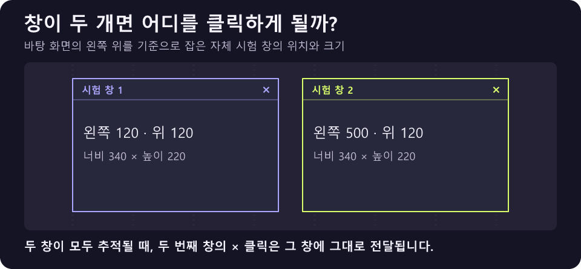

자체 시험에 지정된 화면 좌표와 픽셀 크기를 평면에 그렸습니다. 두 창을 추적할 때 두 번째 창의 닫기 클릭이 그대로 전달되는지 확인합니다. *(Leaflet)*

창이나 아이콘이 보이지 않을 때

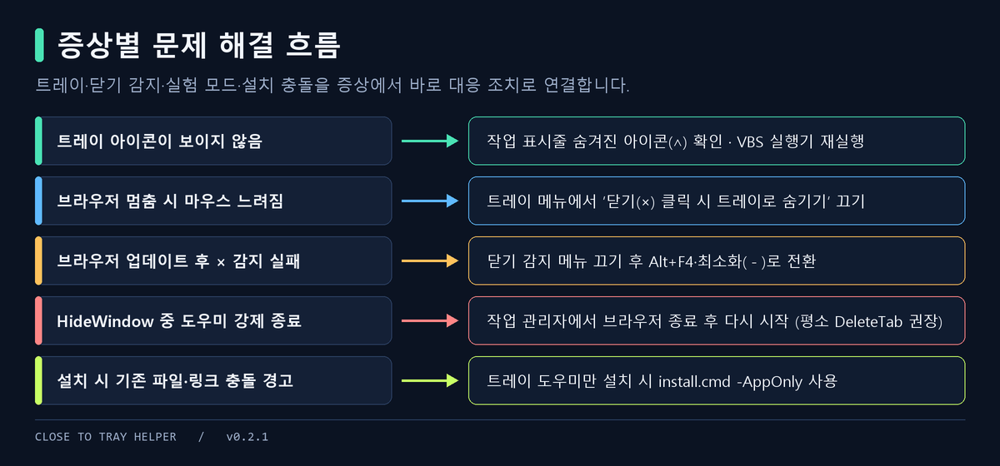

문제가 생긴 증상에서 출발해 트레이의 숨겨진 아이콘, 닫기 감지 설정, 실험 모드의 창 복구, 설치기 정션/충돌 해결 순서로 원인을 좁힐 수 있습니다.

README 첫 화면의 창 이동 애니메이션은 D3로 그렸습니다. 닫기 동작의 분기는 GitHub에서 직접 표시되는 Mermaid 도식으로 볼 수 있습니다. [한국어 README로 돌아가기](../README.ko.md) · [English README](../README.md)
